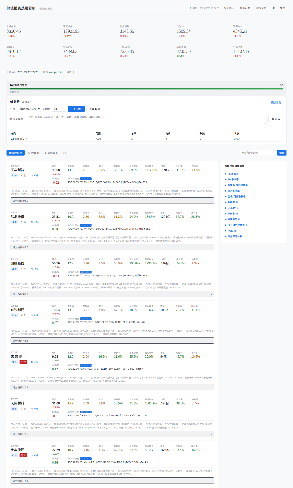
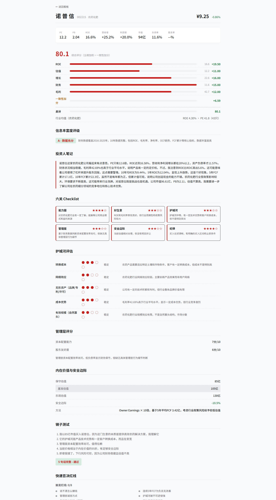

# Stock Dashboard — A 股价值投资研究工作台

[](https://github.com/oldfunk/stock-dashboard/releases/latest)
[](LICENSE)
[](pyproject.toml)

> 全市场数据 → 7 条硬门规 + 五维评分 → 候选池 ≤20 只 · 可复现 FCFF 估值 / 回测 / 前向收益验证
> AI 仅作可选分析/校验：用你自己的 Key，由面板队列触发；不代付 token、不荐股、不接实盘
> 信号前向收益验证（`/outcomes`）、真实年报股息（红利策略 fail-closed）、AI 新闻事件上下文
> 当前状态：v2.0.0 已公开发布；日常维护 + 按需迭代（P2 已冻结）

---

## 界面预览

| 首页候选池 | 个股详情（评分拆解/投资人笔记） |
|---|---|
|  |  |

---

## 快速开始（Python ≥3.10）

```bash
git clone https://github.com/oldfunk/stock-dashboard.git
cd stock-dashboard

# 安装依赖（建议先建 venv）
python -m venv .venv && source .venv/bin/activate
pip install -e .

# 配 Key（AI 分析用你自己的 Key；复制模板按需改，不配也能看数据面板）
cp .env.example .env

# 启动 Web + 内置调度器
python -m src.main serve
# 浏览器打开 http://localhost:9527/
```

首次数据：内置调度器在交易日 15:30 后自动跑全市场采集 + 筛选；等不及可手动跑一次流水线（`python -m src.main run`，约数分钟），再去 `/llm` 页配 Key 做 AI 分析。

### AI 配置（用户自带 Key）

面板不内置模型、不代付 token；AI 分析用你在 `/llm` 配置的 Key，由面板队列触发执行
（整轮/重试失败/单股/卡片直达/详情提问），结果写回笔记与时间线，不在卡片内联展示；
外部程序经数据 API 读写保留兼容（见下）。

```env
# .env（`/llm` 页保存写入；手动脚本同样读它）
STOCK_AI_API_KEY=your_api_key_here
STOCK_AI_API_BASE=https://api.deepseek.com/v1
STOCK_AI_MODEL=deepseek-chat
```

> 历史（2026-09-27）：免 Key 通道（OpenCode Zen / Pollinations）相继不可用；
> 自带 Key 分析已上线（`/llm` 配置 + 队列执行，首只真分析 09-27 跑通）；
> 外部程序经 API 读写保留兼容（见 `docs/agent-api.md`）。详见账本最新 Changelog。

### 生产部署（systemd）

```bash
# /etc/systemd/system/stock-dashboard.service
# ExecStart=<部署目录>/.venv/bin/python -m src.main serve
sudo systemctl enable --now stock-dashboard
```

内置调度器自动完成每日流水线（采集→筛选→K 线），无需额外 cron。AI 分析用自带 Key，经面板队列触发。

---

## 项目结构

```
stock-dashboard/
├── config/
│   ├── config.yaml           # 全局配置（筛选条件、AI、Web、调度）
│   └── strategies.yaml       # 多策略定义（成长/红利/困境反转阈值）
├── src/
│   ├── collector/            # 数据采集层
│   │   ├── akshare_fetcher.py  # AKShare + 腾讯行情（S1–S14 注册表）
│   │   ├── mainfin_fetcher.py  # 东财主要财务指标（年报一站式：ROE/EPS/FCF/披露日等）
│   │   ├── balance_sheet_fetcher.py # 东财 F10 资产负债表（cash/有息负债/净资产）
│   │   ├── cashflow_fetcher.py # 东财 F10 现金流量表（capex/经营现金流）
│   │   ├── dividend_fetcher.py # 年报分红（股息率/分红率，fail-closed）
│   │   └── onboard.py          # 新股上市检测
│   ├── screener/
│   │   └── value_screener.py   # 7 条门规筛选 + 多策略评分
│   ├── analyzer/
│   │   ├── ai_analyzer.py      # 自带 Key 分析（面板队列/手动脚本触发）
│   │   └── watchlist_reviewer.py # 观察池复盘（硬规则本地执行；LLM 决议走用户 Key；节奏 ai_review.days/time 可配，默认周六）
│   ├── models/
│   │   ├── database.py         # SQLite DAO（screening/analysis 等）
│   │   └── ai_watchlist.py     # 观察池 DAO
│   ├── web/
│   │   ├── routes.py           # FastAPI 路由
│   │   ├── stock_metrics.py    # 个股指标单一事实源（标签/格式/好中差阈值）
│   │   ├── templates/          # Jinja2 模板
│   │   │   ├── index.html            # 首页（候选股总览 + AI 观察池 + 钉选 Tab）
│   │   │   ├── stock_detail.html     # 详情页（数据 + 财务 + K 线 + AI 问答/分析触发/笔记时间线）
│   │   │   ├── watchlist_detail.html # 观察池详情
│   │   │   ├── journal.html          # 投资日记（AI 笔记展示）
│   │   │   ├── journal_compare.html  # 日记对比
│   │   │   ├── outcomes.html         # 信号前向收益验证
│   │   │   ├── _stock_card.html      # 个股卡唯一模板（候选/观察池/钉选共用）
│   │   │   ├── _metric_cells.html    # 指标单元格唯一渲染片段
│   │   │   ├── _stock_list.html      # 候选卡列表 partial（薄循环）
│   │   │   └── _watchlist_card.html  # 观察池卡列表 partial（薄循环）
│   │   └── static/             # CSS/JS 静态资源
│   ├── orchestrator.py         # 流水线编排（采集→筛选→入库→日志）
│   ├── outcome_service.py      # 基准/前向收益维护（周六 09:00）
│   ├── scheduler.py            # 内置定时调度（daemon 线程）
│   ├── config.py               # YAML 配置加载
│   └── main.py                 # 入口（serve / run）
├── scripts/
│   ├── stock-ai-slow-feed.sh   # 全量流水线（采集+筛选；内含 AI 步骤当前不可用）
│   ├── run_pipeline.py         # 同上，Python 版
│   ├── retry_ai.py             # 补跑失败 AI 分析（手动，需已配 Key）
│   ├── run_ai_analysis.py      # 慢喂模式（每次 1 只，手动）
│   ├── backtest_topk.py        # TopK 离线回测（防前视；输出有效区间/CAGR）
│   ├── backfill_price_history.py # 三列价格回填（raw/后复权/展示，Sina 源，限速）
│   ├── backfill_financial_extra.py # 已有年报的补充字段回填（cash/capex/notice）
│   ├── backfill_financial_full.py  # 全市场年报回填（约 4500 只，进度/锁/限速）
│   ├── gate.sh                 # 分层门禁（母项目权威 + vendor 记录）
│   ├── verify_valuation.py     # B1 估值验算闸
│   ├── verify_intrinsic.py     # C1 终值验算闸
│   ├── c25_bulk_fill.py        # C2.5 批量补 ROIC/FCF
│   ├── refresh_dividends.py    # 手动刷新年报分红
│   └── refresh_outcomes.py     # 手动刷新基准 + 前向收益
├── tests/                      # pytest（基线下限见 scripts/gate-baseline.txt，生产 gate 全绿）
│   ├── screener/               # 筛选器单测
│   ├── analyzer/               # AI 分析单测
│   ├── models/                 # DAO 表单测
│   └── web/                    # 路由 + 模板渲染单测
├── data/db/                    # SQLite 数据库（gitignore）
├── docs/
│   ├── architecture.md         # 架构真相源
│   ├── roadmap.md              # 总路线
│   ├── value-investing-methodology.md # 价值投资方法论与数据缺口
│   ├── research-os.md          # 投资研究操作系统设计（市场状态/假设/实验/策略/LLM）
│   ├── research-os-tasklist.md # Research OS 任务清单（R0–R6）
│   ├── audit-20261026.md       # 全仓审计清单（数据语义/可靠性/架构/安全/门禁）
│   ├── iteration-log.md        # 迭代进程账
│   ├── handoff.md              # 班次交接速览
│   ├── subproject-protocol.md  # 母子项目协作协议
│   ├── agent-api.md            # 外部程序 API 参考（读数据/写分析/写笔记，保留兼容）
│   ├── scheduled-tasks.md      # 定时任务参考设计（制度由使用者自定）
│   ├── paper-trading.md        # 历史归档（M4a 设计过程保留；现行路线见 roadmap M6）
│   └── strategies-dry-run.md   # 多策略 dry-run 文档
├── paper_trading/            # 子项目全量合并树（subtree，上游独立演进；详见 docs/iteration-log M6）
```

---

## 工作原理

### 核心理念

**不靠排名，只靠及格线。** 7 条硬性门规的指标过滤 + 本地五维评分，每只股票必须通过全部门规才能进入候选池。

列表卡片（候选/观察池/钉选）**共用同一张卡模板**（`_stock_card.html`）与同一套指标定义（`stock_metrics.py`）：标签、格式、好中差阈值、缺值 `--` 完全一致；三视图只允许徽标（池 N 周/加入于/信号）不同。
AI 分析（护城河/管理层/估值/交易信号/历史分析文本）**不再内联展示**，由自带 Key 分析输出、写回笔记（2026-09-21 方向；2026-09-27 起面板队列可触发）。

### 价格与财务数据模型（2026-10-26）

- `kline_daily` 三列价格：`close_raw`（不复权，估值 PE/PB 用）、`close_adj`（后复权，回测总收益用）、`close`（后复权按最新价缩放 = 正数前复权，图表展示用）；另有 `shares`（每日流通股本）。
- `financial_history`：全市场年报回填（目标 5527 只）与补充字段回填分开跑；`backfill_progress` 记录进度，支持断点续跑。
- 估值 fail-closed：缺 FCF / 总股本 / 货币资金 / 有息负债，或 FCF ≤ 0 → 不出估值，页面明确写原因，不用 0 或占位值。


### 每日流水线（交易日 15:30，完整流程见 `architecture.md` §2）

```
1. 腾讯行情 → 全 A 股行情 → 初筛预过滤
2. 财务采集（yjbb 批量 + 东财 F10 直连补三表 + 兜底链 C2/C2.5）
3. 历史财务采集 → financial_history → financial_summary（5y/10y 均值）
4. 质量闸（ROE 覆盖 ≥50%）→ 7 条门规筛选 → 评分 → 候选池 ≤20 只
5. K 线拉取（面板队列触发分析；`retry_ai.py` 等手动脚本需已配 Key）
6. 定时复盘（`ai_review.days/time`，默认周六 00:00）：硬规则 + 监控条件本地执行，LLM 决议走用户 Key（已验证跑通）→ ai_watchlist + ai_journal
```

### 7 条硬性门规

| # | 规则 | 指标 | 豁免 |
|:-:|:-----|:-----|:-----|
| 1 | 5 年均 ROE < 8% → 排除 | `roe_5y_avg` | 高增长(>20%)新上市公司 |
| 2 | 5 年累计 FCF ≤ 0 → 排除 | `fcf_5y_sum` | 小额负 FCF(<1 亿) |
| 3 | 利息覆盖 < 2x → 排除 | `intcov_5y_avg` | — |
| 4 | 毛利率 < 15% → 排除 | `gross_margin` | 高 ROE(≥20%)薄利模式 |
| 5 | OCF/股 ≤ 0 → 排除 | `ocf_per_share` | 高毛利(≥30%)+高增长(≥20%) |
| 6 | 5 年均净利率 < 5% → 排除 | `net_margin_5y_avg` | 高毛利率(≥30%)主动压利 |
| 7 | 5 年稀释 > 20% → 排除 | `share_dilution_5y` | — |

叠加：PE(3~20) / PB(≤3.5) / 营收增长≥0 / 净利增长≥0 / 负债率<65% / 市值 30~50000 亿 / 排除 ST。

### AI 输出结构

```json
{
  "analysis": "投资人笔记风格完整分析",
  "moat_evaluation": [{ "type": "转换成本/网络效应/无形资产/成本优势/有效规模", "score": "1-5", "trend": "稳定", "evidence": "..."}],
  "management_score": { "capital_allocation": "1-10", "shareholder_friendliness": "1-10"},
  "intrinsic_value": { "conservative/base_case/optimistic": "估值(亿)", "margin_of_safety": "安全边际"},
  "reverse_thinking": "2-3 个致死场景",
  "investment_strategy": "仓位和持有周期建议",
  "trade_strategy": { "signal": "BUY/HOLD/AVOID", "confidence": "高/中/低", "buy_zone": "...", "target_price": "...", "stop_loss": "...", "take_profit": "..."}
}
```

候选卡前置摘要已移除（2026-09-21 起列表不再内联 AI）。下述 JSON 仍是 AI 分析
应输出/写回的数据契约（`ai_analysis` 落库格式以此为准）。
其中 `intrinsic_value` 只用于**校验/解释偏离**：系统模型估值（FCFF 两阶段折现）
是权威锚，LLM 不应另给一套主观估值。

---

## 模拟交易（子项目）

[Paper Trading Framework](https://github.com/oldfunk/paper-trading)（独立仓库，MIT）：
A 股模拟盘，策略与撮合解耦，T+1/费率/涨跌幅全建模；AI 交易员日内一次决策（三道闸），休盘做计划、开盘执行。

- 本仓以 subtree 合流（`paper_trading/`，只跟上游 tag），当前 **v0.6.9**；`/paper` 直达面板（:8081）。
- 母子协作协议见 `docs/subproject-protocol.md`（母整合/子施工/人包工头）。

---

## 数据源架构

14 个数据源 S1–S14 完整注册表见 `architecture.md` §5，含兜底链与契约单测要求：

- **行情**：腾讯为主 S1，兜底新浪 → AKShare 自算
- **财务**：AKShare `stock_yjbb_em` 为主 S2，兜底 C2 东财直连
- **深度/历史**：东财 F10 三源（mainfin / 资产负债表 / 现金流表）为主，AKShare 摘要为补充；mainfin 一次返回 ROE/EPS/毛利率/净利率/增长/负债率/ROIC/FCF/披露日/净资产/总资产/总股本
- **K 线 / tick**：历史全量回填用 Sina `stock_zh_a_daily`（不复权+后复权，3–5s/只，含每日股本）；东财 `push2his` 约 35 次快速请求后限流，腾讯 `fqkline` 约 38s/只且长历史负价，均保留为备选
- **股息 / 基准**：东财年报分红 S9 + 东财指数日线 S10；新浪指数为兜底（sh000922 只到 2019）

> 限速是硬约束：历史回填默认 `--sleep 0.4–0.5`，单实例锁 + 进度表；东财/腾讯失败指数退避，连续失败熔断。禁止并发多实例抢同一上游。

> 事故教训已固化为三条铁律：删适配函数 = 删注册表行 + 删契约单测，三者同 commit（见 `architecture.md` §5.2）。

---

## 脚本

| 命令 | 用途 |
|---|---|
| `python -m src.main serve` | 启动 Web + 内置调度器 |
| `python -m src.main run` | 执行一次采集 + 筛选（不含 AI 分析） |
| `bash scripts/stock-ai-slow-feed.sh` | 全量脚本（采集 + 筛选；内含 AI 步骤当前因通道死亡不可用） |
| `python3 scripts/retry_ai.py` | 补跑最新 run 中失败的 AI 分析（手动；需已配 Key） |
| `python3 scripts/retry_ai.py --all-failed` | 扫所有 run 里的失败记录 |
| `python3 scripts/retry_ai.py --dry-run` | 只列清单不调用 |
| `python3 scripts/run_ai_analysis.py` | 慢喂模式（每次 1 只，手动） |
| `python3 scripts/verify_valuation.py` | B1 估值验算闸 |
| `python3 scripts/verify_intrinsic.py` | C1 终值验算闸 |
| `python3 scripts/c25_bulk_fill.py` | C2.5 批量补 ROIC/FCF |
| `python3 scripts/backfill_price_history.py --all --sleep 0.5` | 三列价格回填（Sina，959 只，断点续跑） |
| `python3 scripts/backfill_financial_extra.py --until-done` | 已有年报的 cash/capex/notice 补充字段回填 |
| `python3 scripts/backfill_financial_full.py --until-done --sleep 0.4` | 全市场年报回填（约 4500 只） |
| `python3 scripts/backtest_topk.py --start 2016-01-01` | TopK 回测（后复权；输出有效区间/CAGR） |
| `bash scripts/gate.sh` | 分层门禁（母项目权威 + vendor 记录） |

---

## 配置

详见 `config/config.yaml`：

| 配置项 | 说明 |
|---|---|
| `screener.conditions.*` | 7 条门规阈值（ROE/FCF/利息覆盖/毛利率/OCF/净利率/稀释） |
| `screener.multi_strategy` | 多策略开关（默认 false，true 走 strategies.yaml 三池） |
| `strategies.yaml` | growth/dividend/turnaround 三策略阈值 + alpha_criteria + exit_triggers |
| `schedule.daily_update_time` | 每日运行时间（默认 15:30） |
| `web.port` | 看板端口（默认 9527） |
| `ai.*` | 自带 Key 的 LLM 配置（`/llm` 页写入；免费通道已死；`ai.fallback` 备用通道保留） |
| `ai_review.*` | 定时 AI 复盘（`days`/`time` 节奏 + 观察池容量 + 硬规则） |

本地覆盖：`config/local.yaml`（gitignore），YAML 合并到 config.yaml。

---

## 技术栈

- **数据采集** — 腾讯/东财/新浪直连（curl/urllib/requests）+ AKShare（Sina 日线、分红、指数、业绩报表）
- **存储** — SQLite（WAL 模式，`data/db/stock_dashboard.db`）
- **AI 分析** — 用户自带 Key（`/llm` 页配置模型，面板队列执行；外部程序经 API 读写保留兼容）。免 Key 通道已不可用。
- **Web 看板** — FastAPI + Jinja2（候选/观察池/钉选共用 `_stock_card.html` + `stock_metrics.py` 单一指标源；只展示数据，不内联 AI 分析）
- **调度** — 内置 `src/scheduler.py`（daemon 线程，采集→筛选→K 线；不触发 AI）+ systemd 常驻
- **验证** — `bash scripts/gate.sh`（母项目权威 + vendor 记录；基线 702 / 242，只升不降）

---

## 方法论来源与设计取舍

价值投资门规与分析框架为本项目自有实现，方法论原则（能力圈、护城河、安全边际、一票否决纪律）源自公开价值投资常识。设计取舍：

1. **自动化** — 采集/筛选/复盘可自动运行；AI 分析需用户 Key 触发
2. **本地数据仓库** — 逐日累积历史财务数据
3. **A 股适配** — 数据源腾讯/东财/新浪/AKShare，规则兼容 A 股特性
4. **简化代理指标** — 利息覆盖/稀释率/FCF 使用可稳定获取的财报字段（不依赖单一上游）
5. **结构化分析契约** — AI 分析应输出护城河/管理层/估值/策略 JSON（格式见上节；面板只展示数据与笔记，不内联分析）
6. **落库追踪** — 论点/假设/红线/笔记全部落库跨期对照，不做事后一次性报告

---

## 开发

### 工作流

1. 从 `main` 切出 `nightly/YYYYMMDD` 分支（外部贡献走 Pull Request）
2. 改动 + 单测 + 全仓 pytest 零失败（基线下限见 `scripts/gate-baseline.txt`，只升不降；确切数见账本最新 Changelog）
3. 合并到 `main`（维护者直接合并；外部 PR 由维护者审核合并）
4. 生产部署由维护者执行（systemd `stock-dashboard.service` :9527；部署目标配置不入库）

### 约束

- 单模块改动 + 单测 + 零 emoji（仅 → ↑ ↓ ✓）
- 迭代在 `nightly/*`，合并到 `main`（维护者直接合并，外部 PR 审核合并；规则见 `AGENTS.md`）
- 踩坑铁律 6 条：见 `iteration-log.md` §工程约定

### 文档约定

单一事实源，不重复维护：

| 文档 | 定位 |
|---|---|
| `docs/architecture.md` | 架构真相源：结构图、流水线、模块边界、数据源 S1–S14 |
| `docs/roadmap.md` | 总路线（P1 面板深化 → P2 体验优化） |
| `docs/iteration-log.md` | 迭代进程账（含 backlog） |
| `docs/handoff.md` | 班次交接速览（历史追加不删） |
