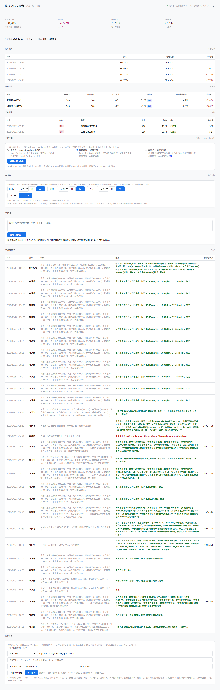

# Paper Trading Framework

[](https://github.com/oldfunk/paper-trading/actions/workflows/test.yml)
[](https://github.com/oldfunk/paper-trading/releases/tag/v0.1.0)
[](LICENSE)
[](requirements.txt)

本地事件驱动型模拟交易框架（Paper Trading Framework），针对 A 股市场，纯本地运行，不依赖任何第三方券商在线 API。

## 特性

- **策略与撮合解耦**：`BaseStrategy` 抽象基类返回标准交易信号，`PaperBroker` 独立处理订单撮合
- **T+1 持仓冻结**：显式区分 `total_volume`（总持仓）与 `available_volume`（可用持仓），当天买入当天不可卖出
- **真实成本扣除**：
  - 买入：佣金 0.025%（最低 5 元）+ 过户费 0.001%
  - 卖出：佣金 0.025%（最低 5 元）+ 印花税 0.05%（卖出单边）+ 过户费 0.001%
- **可配置滑点**：支持固定滑点（0.01 元）或百分比滑点（0.1%）
- **本地 SQLite 持久化**：行情数据（`data.db`）与账户账本（`paper_account.db`）分离
- **双数据源**：优先新浪财经（稳定），自动重试机制
- **风控管理**：单笔限额、仓位上限、最大回撤止损
- **AI 交易员**：固定交易时段运行（09:30–11:30/13:00–15:00）——收盘后 16:30–18:30 数据定稿时做下一交易日计划，开盘 09:30–10:00 执行计划，盘中只在异动时复盘；JSON 钳制执行+幂等闸+日亏熔断；**离场三件套**（止损/放飞/清仓）写进系统提示，卖出条件强制对应真实持仓（解析+挂单双层校验），**财联社要闻/政策快讯**辅助“催化”判断（`agent.news_enabled` 可关）；决策同时可输出**条件单**，盘中由规则引擎每分钟盯价执行（低于手续费地板/池外/非法类型/卖出无持仓会返回 `parse_rejected`，不静默）；`agent event` 在价格异动/持仓回撤时触发复盘（冷却+每日预算），不逐笔调用 LLM
- **规则引擎（量化执行层）**：9 种规则（均线交叉 / RSI 区间 / 价格档位 / 涨跌幅阈值 / 移动止损 / 时间止损 / 偏离当日均价 / 日内冲高回落 / 分钟均线交叉），盘中守护进程每 60 秒判一次，**与 AI 走同一把风控尺子和同一个撮合口径**
- **回测纪律**：T 日收盘信号最早 T+1 成交、真实费率（含最低 5 元佣金）、最低单 5000 元、日内买入当天不可卖；回测与实盘共用 `rules.py` 同一套判定，杜绝未来函数
- **参数网格**：批量回测参数变体，按**超额收益**（对比等权买入持有）排序；配套**样本外检验**（前 60% 选参数、后 40% 检验）做过度拟合体检，掉下来的参数不进生产规则集
- **条件单**：AI 或人工只给「触发条件 + 有效期 + 理由」（例：跌破 260 买 1 万，3 个交易日内有效），盘中引擎每分钟核对实时价，触发即过风控下单；不触发就是 0 成本，每条都留痕可复盘
- **投资方案三选一**：[Stock Dashboard](https://github.com/oldfunk/stock-dashboard) 价值 / 通用交易（默认）/ 自定义自然语言指令
- **全市场选股漏斗**：母项目夜间扫全市场 → 候选池；AI 还可在候选之外**自主提名任意 A 股**（程序校验代码+补数据后才进决策），手填池只作兜底
- **LLM 万能接入**：OpenAI 兼容接口 + 主流厂商预设 + 手填模型名，只咨询不交易
- **盘中实时**：腾讯行情同源，面板现价盘中实时展示（NAV/结算永远收盘口径）
- **只读集成**：[Stock Dashboard](https://github.com/oldfunk/stock-dashboard) 在同一台机器时，全市场候选池/代码表/基本面/论点自动可用，缺席静默回退

## 目录结构

```
paper-trading/
├── config.yaml                # 单一真相源（账户/交易/策略/风控/节假日/Agent）
├── strategy.local.yaml        # 本机覆盖（当前方案+自定义指令，gitignored，不提交）
├── secrets.local.json         # 本机密钥（0600，gitignored，不提交）
├── requirements.txt
├── MERGE_GUIDE.md             # 与 Stock Dashboard 合并契约
├── tests/                     # 离线回归单测（core/agent/runtime/calendar/llm/schemes/schedule/integration/realtime/dashboard）
└── paper_trading/
    ├── __init__.py
    ├── main.py                    # 独立入口：自动化调度与结算
    ├── cli.py                     # 命令行入口（JSON信封+锁+preview）
    ├── dashboard.py               # 只读面板（浅色主题+AI问答+方案切换）
    ├── models/types.py            # Bar/Order/Fill/Position/Signal...
    ├── data/
    │   ├── akshare_fetcher.py     # 新浪优先+东财fallback+北交所映射
    │   ├── db_manager.py          # SQLite 行情库（limit取最近N根）
    │   └── realtime.py            # 腾讯盘中实时（60s缓存，仅交易时段）
    ├── strategy/
    │   ├── base_strategy.py       # BaseStrategy 抽象基类
    │   ├── ma_cross_strategy.py   # 仅最后一根交叉才发信号（防重复）
    │   └── schemes.py             # 投资方案三选一（母价值/通用/自定义）
    ├── agent/                     # AI 交易员（决策环+计划表+固定运行时刻+事件复盘+钳制执行）
    ├── engine/                    # 规则引擎（9 种规则/回测/参数网格/条件单/盘中守护）
    │   ├── rules.py               # 纯函数判定（日线 6 种 + 日内 3 种）
    │   ├── backtest.py            # 回测器（真实费率/基准买入持有/T+1/分钟重放）
    │   ├── optimize.py            # 参数网格搜索（按超额收益排序）
    │   ├── conditional.py         # 条件单仓库（挂条件，不立即成交）
    │   ├── ai_conditions.py       # AI 出条件单的提示词与解析校验
    │   ├── runner.py              # 盘中守护（规则 + 条件单同一循环）
    │   └── state.py               # 日内预算/冷却/触发落库（重启不丢）
    ├── broker/paper_broker.py     # T+1交易日历/100股/涨跌停/拒单落库/含费成本
    ├── portfolio/portfolio.py
    ├── risk/risk_manager.py       # 多标的价格表+回撤熔断
    ├── llm/                       # OpenAI兼容调用+密钥管理（只咨询）
    ├── integration/               # Stock Dashboard 只读连接（全市场代码表/池/基本面/论点）
    └── utils/                     # logger/trading_calendar/config/run_lock
```

## 安装

```bash
git clone https://github.com/oldfunk/paper-trading.git
cd paper-trading
pip install -r requirements.txt
```

## 使用

### 快速开始

```bash
# 全量更新行情 + 运行
python -m paper_trading.main --symbols 600519 000858 601318 --full

# 增量更新 + 运行
python -m paper_trading.main --symbols 600519 000858 601318
```

### 配置

编辑 `config.yaml`（与仓库内实际默认值一致；用户自选覆盖放 gitignored 的 `strategy.local.yaml`）：

```yaml
stock_pool:
  - "000858"   # 五粮液
  - "601318"   # 中国平安
  - "600036"   # 招商银行
  - "601398"   # 工商银行
  - "600900"   # 长江电力
  - "000333"   # 美的集团
  - "600887"   # 伊利股份
  - "600276"   # 恒瑞医药
  - "601888"   # 中国中免
  - "000651"   # 格力电器

account:
  initial_cash: 100000.0

trading:
  commission_rate: 0.00025    # 佣金率 0.025%
  commission_min: 5.0         # 单笔最低佣金
  stamp_duty_rate: 0.0005     # 印花税 0.05%（卖出单边）
  transfer_fee_rate: 0.00001  # 过户费 0.001%（双向）
  slippage_fixed: 0.01        # 固定滑点（元）
  slippage_pct: 0.001         # 百分比滑点
  use_slippage_pct: false
  holidays: []                # 额外节假日 YYYY-MM-DD（交易日历跳周末，节假日需补）

strategy:
  active: general             # mother/general/custom 三选一
  short_window: 5
  long_window: 20
  buy_volume: 100
  sell_volume: 100

risk:
  max_single_order_value: 30000.0
  max_position_pct: 0.3
  max_total_position_pct: 0.95
  max_drawdown_pct: 0.20

agent:
  enabled: true
  max_orders_per_run: 3       # 日内最多几笔
  max_order_value: 20000.0    # 单笔上限
  daily_loss_halt_pct: 0.05   # 日亏熔断
  llm_timeout: 120.0
  llm_retries: 1              # 仅超时重试
  llm_max_tokens: 8192
  llm_thinking: disabled      # 格式受限决策默认关 thinking
  picks_enabled: true         # AI 自主提名（候选之外点名全市场个股）
  picks_max: 5                # 单轮最多提名几只（1-10）
  conditions_enabled: true    # AI 可输出条件单（现在不成交，由引擎盯价）
  max_conditions: 5           # 单轮最多几条条件单
  condition_max_days: 3       # 条件单最长有效天数
  event_enabled: true         # 价格异动/回撤触发 AI 复盘
  event_price_move_pct: 3.0   # 日内涨跌幅阈值（绝对值）
  event_drawdown_pct: 5.0     # 持仓自峰值回撤阈值
  event_cooldown_min: 30      # 同标的复盘冷却
  event_min_interval_min: 15  # 任意两次复盘最小间隔
  event_max_calls_per_day: 6  # 每日模型调用预算
  event_max_conditions: 3     # 单次事件复盘最多几条条件单
```

> `stock_pool` 只是兜底（母项目缺席且无观察池时才用）。默认 `--pool-from auto`：
> 全市场量化筛选 → 观察池 → 手填池逐级降级；AI 另可在候选之外自主提名个股
> （`--no-picks` 关闭）。

## 界面预览

浏览器/手机打开面板（局域网，浅色主题，手机自适应）——本机用 `http://127.0.0.1:8080`，
同一 Wi-Fi 下的其他设备用 `http://<运行机器的局域网IP>:8080`（例如树莓派是 `http://192.168.1.50:8080`，IP 以你家路由器分配为准）：



## 核心模块

### 数据采集（Data Module）

```python
from paper_trading.data.akshare_fetcher import AkshareFetcher
from paper_trading.data.db_manager import DataDBManager

# 获取数据
bars = AkshareFetcher.fetch_daily('600519', start_date='20240101', end_date='20241231')

# 持久化
db = DataDBManager('data.db')
db.upsert_bars(bars)
```

### 策略（Strategy）

```python
from paper_trading.strategy.ma_cross_strategy import MACrossStrategy

strategy = MACrossStrategy(short_window=5, long_window=20)
signals = strategy.generate_signals({'600519': bars})
# 返回: {symbol: Signal(direction=SignalType.BUY, volume=100, price=1391.08, ...)}
```

### 撮合（Broker）

```python
from paper_trading.broker.paper_broker import PaperBroker
from paper_trading.models import Order, OrderType

broker = PaperBroker('paper_account.db')
order = Order(symbol='600519', direction=1, volume=100, 
              order_type=OrderType.LIMIT, limit_price=1391.08)
result = broker.submit_order(order)
```

### 风控（Risk）

```python
from paper_trading.risk.risk_manager import RiskManager

risk = RiskManager(max_position_pct=0.3, max_drawdown_pct=0.20)
ok, reason = risk.check_signal(signal, price, cash, positions, total_value)
```

## 数据库 Schema

### data.db（行情数据）

- `daily_bars(symbol, timestamp, open, high, low, close, volume, turn)`
- `stock_pool(symbol, name, added_at)`
- `minute_bars(symbol, ts, open, high, low, close, volume, amount)` — 1 分钟 K 线（日内规则/条件单；只存最近几日）
- `quote_log(ts, symbol, price, prev_close, volume)` — 盘中实时快照

### paper_account.db（账户账本）

- `account(id, cash, initial_cash, created_at)`
- `positions(symbol, total_volume, available_volume, avg_cost, last_update)`
- `orders(order_id, symbol, direction, volume, order_type, limit_price, status, ...)`
- `fills(fill_id, order_id, symbol, direction, volume, price, commission, stamp_duty, transfer_fee, timestamp)`
- `nav_history(id, timestamp, cash, market_value, total_value, pnl, pnl_pct)`
- `t1_freeze(id, symbol, volume, freeze_date, unfreeze_date, is_unfrozen)`
- `op_log(id, timestamp, action, params, ok, result, cash_after, total_value_after)` — AI/人工操作流水
- `agent_plans(id, plan_date, symbols, plan_json, status, created_at, executed_at)` — 休盘计划
- `conditional_orders(id, created_at, day, source, symbol, side, cond_type, cond_value, volume, value, expiry, status, ...)` — 条件单（armed/filled/cancelled/expired/rejected）
- `engine_state / engine_triggers` — 引擎日内预算、冷却与触发记录（重启不丢）

## 运行示例

```
=== Run-Daily started at 2026-09-21T14:45:44 ===
Fetching 600519 from 20230922 to 20260921 (adjust=qfq)
Fetched 724 bars for 600519
Signal: BUY 600519 @ 1598.65 (Golden cross: MA5 crossed above MA20)
Order filled: BUY 100 600519 @ 1598.660
NAV: total=999628.43, pnl=-371.57 (-0.04%)

============================================================
  账户摘要 (2026-09-21 14:45:44)
============================================================
  可用资金:      840,092.43
  持仓市值:      159,536.00
  总资产:        999,628.43
  浮动盈亏:         -371.57 (-0.04%)
------------------------------------------------------------
  持仓明细:
    600519: 100股 (可用0) @ 成本1598.66 / 现价1595.36 / 市值159,536
============================================================
=== Run-Daily completed ===
```

## 命令行（CLI）

本项目提供 `cli.py` 命令行入口（人类与机器通用，`--json` 输出机器可读信封）：

### CLI 命令

```bash
# 查看账户状态（统一信封 {"ok","data","error"}，失败非0退出码）
python -m paper_trading.cli status --json

# 执行每日结算（缺省=config.yaml 股票池；带文件锁防并发；--dry-run 只预览不下单）
python -m paper_trading.cli run --symbols 600519 000858 --json

# 只同步行情+名称，不交易（日内任意时间可执行）
python -m paper_trading.cli sync --json

# 除权除息人工调整（sync 检测到历史收盘被回溯调整时会写 op_log: data:revision）
python -m paper_trading.cli corporate apply --symbol 600519 --ex-date 2026-06-20 --cash-per-share 0.5 --share-ratio 0.3 --json

# LLM 接入（只咨询，不交易；Key 只落本地 secrets.local.json）
python -m paper_trading.cli llm config --preset deepseek --api-key xxx --model deepseek-chat
# 本地/局域网模型：只给地址，不用令牌（Ollama/LM Studio/vLLM/自建网关）
python -m paper_trading.cli llm config --preset ollama --model qwen3:8b
python -m paper_trading.cli llm models --json
python -m paper_trading.cli llm ask --prompt "评价一下当前持仓" --json

# AI 交易员（固定运行时刻：开盘执行计划 / 收盘做次日计划 / 盘中异动复盘）
# 手动 run 不再受旧定时队列限制
python -m paper_trading.cli agent run --dry-run --json
python -m paper_trading.cli agent run --json
# 运行时 tick（cron 调这个）：09:30–10:00 执行当天计划；
# 16:30–18:30 数据定稿后做下一交易日计划；其他时间静默跳过
python -m paper_trading.cli agent tick --json
# 交易日历（同步“未来交易日”优先：只留最近 45 天 + 未来全部；失败回退周末+手填 holidays）
python -m paper_trading.cli calendar sync --json
python -m paper_trading.cli calendar status --json
# 旧版 AI 定时队列（已停用，仅兼容查看/导出）
python -m paper_trading.cli agent schedule list --json
# 事件驱动复盘：只有异动/回撤才调 LLM，产出条件单（不直接下单）
python -m paper_trading.cli agent event --json
python -m paper_trading.cli agent event --dry-run --json
# 人工补跑：不受旧队列限制（--ignore-schedule 保留为兼容参数）
python -m paper_trading.cli agent run --ignore-schedule --json
# 休盘做计划（存下一交易日，开盘自动执行；不碰账本）
python -m paper_trading.cli agent run --plan-only --json
# 要闻/政策快讯开关在 config.yaml（agent.news_enabled / agent.news_limit；
# akshare 财联社电报，15 分钟缓存，抓取失败自动回空不阻断决策）
# 股票池来源（auto=全市场筛选优先→观察池→手填池兜底；需 Stock Dashboard 在同一台机器）
python -m paper_trading.cli agent run --pool-from screening --pool-limit 20 --json
# 关闭 AI 自主提名（只用程序候选池）
python -m paper_trading.cli agent run --no-picks --json

# 1 分钟 K 线（日内规则与条件单的分钟级判定需要；默认 5 分钟粒度）
python -m paper_trading.cli minute pull --symbols 000001 --days 30 --json
python -m paper_trading.cli minute stat --json
```

### 投资方案（永远 3 种；合并/独立通用）

```bash
# 查看与切换（写 gitignored 的 strategy.local.yaml，git 树保持干净）
python -m paper_trading.cli scheme list --json
python -m paper_trading.cli scheme use --name custom --instruction "只做银行股反弹" --json
# 单次指定
python -m paper_trading.cli agent run --scheme custom --dry-run --json
```

三类：① 母价值（Stock Dashboard 价值理念，需 Stock Dashboard 在同一台机器，否则不可选；
合并后选股范围取母筛选）；② 通用交易（默认，MA5/20）；
③ 自定义（面板/CLI 用自然语言写交易指令，AI 照此执行，风控钳制不变）。

### 下单、历史与面板

```bash
# 下单前试算（不落库）
python -m paper_trading.cli preview --symbol 600519 --direction buy --volume 100 --json

# 买入/卖出（强制走风控，100股整数倍；拒单落库）
python -m paper_trading.cli buy --symbol 600519 --volume 100 --json
python -m paper_trading.cli sell --symbol 600519 --volume 100 --price 1500.00 --json

# 查看历史
python -m paper_trading.cli nav --json
python -m paper_trading.cli history --type orders --json
python -m paper_trading.cli history --type fills --json

# 回归测试（全量单测，离线可跑）
python -m pytest tests/ -q

# 打开仪表盘（只读网页；本机浏览器访问 http://127.0.0.1:8080，局域网其他设备用运行机器的局域网 IP 同端口）
python -m paper_trading.dashboard --port 8080
```

### 规则引擎（盘中量化执行层）

分工：**AI 负责选股与策略设计（慢、贵，一天几次）；规则引擎负责择时执行（快、免费、每分钟）**。
两者共用同一个 `RiskManager` + `PaperBroker`，所以口径一致。

```bash
# 查看/校验规则集（enabled 默认 false：显式开启才盘中自动交易）
python -m paper_trading.cli engine config --json

# 回测规则集（T+1 成交、真实费率、带基准买入持有与超额、ASCII 净值曲线）
python -m paper_trading.cli engine backtest --days 250 --curve --json

# 参数网格搜索：按超额收益排序（ma_cross / rsi_zone / trailing_stop）
python -m paper_trading.cli engine optimize --grid ma_cross --symbols 000001 --days 250 --json
# 样本外检验（过拟合体检）：前 60% 选参数，后 40% 检验——掉下来就是拟合出来的
python -m paper_trading.cli engine walkforward --grid ma_cross --symbols 000001 --days 250 --split 0.6 --json
# 日内网格需要分钟线（分钟线只存最近一段，样本极小，结论仅供参考）
python -m paper_trading.cli minute pull --symbols 000001 --days 30
python -m paper_trading.cli engine optimize --grid vwap_dev --symbols 000001 --json

# 跑一轮（守护进程入口在 python -m paper_trading.engine）
python -m paper_trading.cli engine run --dry-run --json
```

9 种规则（`engine.rules` 里都是纯函数，回测与实盘同一份代码）：

| 类型 | 触发 | 说明 |
| --- | --- | --- |
| `ma_cross` | 短均线上穿/下穿长均线 | 方向型，金叉买死叉卖 |
| `rsi_zone` | RSI 下穿下界 / 上穿上界 | 方向型 |
| `price_level` | 现价跌破/升破某个价 | 方向由 action.side 定 |
| `pct_change` | 日内涨跌幅超过阈值 | 方向型 |
| `trailing_stop` | 自持仓期高点回落 N% | 建议 `action: {side: sell, all: true}` |
| `time_stop` | 持有满 N 个交易日 | 建议 `action: {side: sell, all: true}` |
| `vwap_dev` | 现价偏离当日均价 ±N% | 日内，需分钟线；低于买、高于卖 |
| `intraday_pullback` | 自日内高点回落 N%（可选先涨 M%） | 日内，需分钟线 |
| `minute_ma_cross` | 分钟均线金叉/死叉 | 日内，需分钟线 |

规则集写在 `config.yaml` 的 `engine.rules`（仓库内是空列表），本机覆盖写 `engine.local.yaml`。

**分钟线从哪来**：默认 5 分钟 K 线（新浪源，实测可取数月历史，48 根/交易日；成交额用典型价×成交量估算），
`--period 1` 才是 1 分钟（腾讯分时，只有当日）。刻意不混用不同粒度——同一张表里混着 1 分钟和 5 分钟，
均线类规则前后就没法比。`min_bars` 数的是**库里存的 K 线根数**，5 分钟线下 48 根约等于一整天。

**回测口径**（两条不变量，单测锁死）：① 资金守恒——卖出回款必须回到现金，权益 = 现金 + 市值；
② 缺当日日线的票沿用最近一次收盘计价（不当 0），但当天没数据也**不成交**（不拿旧价假装成交）。

**回测-实盘口径（M1）**：信号 T 日收盘判定、**T+1 开盘价**成交（±0.01 滑点）；当日买入 T+1 冻结；
`once` 按交易日（不是整段回测一次）；开盘一字涨停不买、一字跌停不卖、停牌不成交；
默认接入与实盘同一组仓位风控。`engine optimize/walkforward` 与 CLI 回测使用同一套滑点/风控参数。

**除权除息（M1 降级保护）**：前复权数据在除权后会重算历史收盘，`sync` 检测到差异会写
`op_log`（`data:revision`）并在输出 `revisions` 里提示；但**不会自动改账本**。除权日 NAV/股数
可能失真，必须人工核对后用 `corporate apply` 调整；自动调整与分红税细化在 M1.5。

### 实测结论（截至 2026-10，Pi 真机数据）

先说结论：**当前规则集没有证明自己有 alpha，生产配置保持 `engine.enabled: false`。**

`engine walkforward`（前 150 天选参数、后 100 天检验）在真实数据上给出的事实：

| 网格 | 样本内第一名 | 它在样本外的表现 | 样本外事后最优 |
|---|---|---|---|
| `ma_cross` | 002192 short=10/long=30（-26.92%） | +6.25% | 000792 short=20/long=30（+12.94%） |
| `rsi_zone` | 002192 n=14 lower=30 upper=75（-4.28%） | +1.58% | 002192 n=14 lower=25 upper=70（+14.25%） |

两个网格的共同点：**样本内排第一的，在样本外都不是最好的**（甚至接近倒数）。
每个窗口只有 3~7 笔成交——这个量级下排名基本是噪声，不是 alpha。

所以：
- 网格输出只能当"待验证线索"，**不能**直接写进生产规则集（也是 `AGENTS.md` 的硬规则）
- 想让引擎真的开始自动交易，先要**更多标的 + 更长样本 + 样本外仍然为正**
- 工具已就位：`engine walkforward` / `engine optimize` / 面板「样本外检验」

（框架本身算得对：v0.5.1 修完账目 bug 后，同一段数据策略 -0.86% vs 基准 +1.24%，
超额 -2.1%——"略跑输一直拿着不动"，这就是当前规则集的真实水平。）

### 条件单（AI 出条件，盘中触发）

条件单**现在不成交**，只挂一个可验证的触发条件（触发价或涨跌幅）；盘中引擎每分钟核对实时价，
触发才过风控下单。不触发就是 0 成本，每条都留痕（待触发/已成交/已撤销/已过期/被拒），可复盘 AI 准不准。

`engine.enabled: false`（默认）时，规则与条件单都**只判定不成交**——开关关着时触发的条件单保持"待触发"，
不会被误标成"已拒绝"，等人开了开关再说。

```bash
# 人工挂一条：跌破 9.5 买 2 万，2 天内有效
python -m paper_trading.cli cond add --symbol 000001 --side buy \
  --cond price_below --value-trigger 9.5 --value 20000 --expiry 2026-10-22 --note "回踩支撑"

# 让 AI 设计（只出条件，挂上不立即成交；池外代码/非法条件/金额越界一律丢弃）
python -m paper_trading.cli cond design --pool-from auto --max 5 --max-days 3
python -m paper_trading.cli cond design --dry-run --json     # 只看 AI 想挂什么

# 查看 / 撤销 / 手动跑一轮检查
python -m paper_trading.cli cond list --status armed --json
python -m paper_trading.cli cond cancel --id 3
python -m paper_trading.cli cond tick --dry-run --json
```

条件单状态存在 `paper_account.db` 的 `conditional_orders` 表里，守护进程每轮自动检查。

### 仪表盘

非技术用户直观查看入口 —— 本机浏览器打开 `http://127.0.0.1:8080`（手机/其他设备用同一 Wi-Fi 下运行机器的局域网 IP 同端口）：

- **账户卡片**：总资产 / 浮动盈亏（红涨绿跌）/ 可用资金 / 持股市值
- **资产走势**：NAV 历史表
- **当前持仓 / 订单记录**：现价（盘中显示实时价徽标）/ 盈亏，成交/拒绝状态
- **AI 问答**：提问自动附带账户快照，回答记流水
- **AI 操作流水**：每次操作的时间、动作、参数、结果（成交价/拒单原因）、操作后资产，详情列自动换行
- **投资方案**：母价值 / 通用 / 自定义三选一（自定义指令折叠填写）
- **运行时刻**：只读展示代码写死的节奏——交易日 09:30–11:30 / 13:00–15:00；09:30–10:00 执行前一交易日计划；16:30–18:30 数据定稿后做下一交易日计划；盘中异动才调 AI；规则/条件单每分钟执行。同时显示交易日历缓存覆盖范围与当前待执行计划
- **规则引擎**：规则集一览（含开关/间隔/单笔下限/校验结果）、一键回测（策略 vs 基准买入持有 + 超额 + ASCII 净值曲线）、参数网格排序表、样本外检验表、最近触发记录
- **条件单**：挂条件（代码/方向/触发类型/触发值/金额/有效期）→ 列表显示待触发/已成交/已撤销/已过期/被拒，可撤销、可让 AI 设计
- **模型设置**：厂商预设 + 拉取模型列表（不需要口令，失败直接显示原因）+ 手填模型名（Key 掩码显示，保存一次长期有效）。**本地/局域网接口（Ollama / LM Studio / vLLM / 自建网关）只填接口地址即可，不用令牌**；这类预设会自动清掉之前保存的云端 Key（不把 Key 发到别的机器）
- **模型兼容**：始终思考的模型（GLM 5.3 系列等）会自动降到 low 档并抬高输出预算；答案被思考吃光时直接报「只输了思考过程」，不会静默返回空回答

流水写入 `paper_account.db` 的 `op_log` 表（`broker.log_operation`），仪表盘纯只读，可与交易进程并存。

### Cron 定时任务（二选一，不可同日混跑）

```bash
# MA 规则交易（工作日 16:45；等数据源今日线落定后再结算，保守时间）
(crontab -l 2>/dev/null; echo "45 16 * * 1-5 cd /home/pi/paper-trading && venv/bin/python -m paper_trading.cli cron-run --json >> run.log 2>&1") | crontab -

# AI 交易员（v0.6.5 推荐：固定运行时刻由代码写死，不再读旧定时队列）
# 开盘执行：09:30–10:00 每 5 分钟，只消费当天 pending 计划；无计划静默
(crontab -l 2>/dev/null; echo "30,35,40,45,50,55 9 * * 1-5 cd /home/pi/paper-trading && venv/bin/python -m paper_trading.cli agent tick --json >> agent.log 2>&1") | crontab -
# 收盘计划：16:30–18:30 每 5 分钟；数据定稿到今天才问模型，成功即停
(crontab -l 2>/dev/null; echo "*/5 16-18 * * 1-5 cd /home/pi/paper-trading && venv/bin/python -m paper_trading.cli agent tick --json >> agent.log 2>&1") | crontab -
# 事件驱动复盘（盘中每分钟检查，错开整点 tick；无异动/冷却/预算用完时零 LLM 调用）
(crontab -l 2>/dev/null; echo "1-59 9-11,13-14 * * 1-5 cd /home/pi/paper-trading && venv/bin/python -m paper_trading.cli agent event --json >> agent.log 2>&1") | crontab -
# 交易日历同步（每周六 10:00；同步未来交易日，只留最近 45 天+未来；失败回退周末+holidays）
(crontab -l 2>/dev/null; echo "0 10 * * 6 cd /home/pi/paper-trading && venv/bin/python -m paper_trading.cli calendar sync --json >> calendar.log 2>&1") | crontab -

# 规则引擎守护（盘中每分钟一轮：判规则 + 检查条件单，触发才过风控下单）。
# 规则集 enabled: true 才会真下单；engine.enabled=false 时只判定并落 blocked_disabled。
# 前台常驻：venv/bin/python -m paper_trading.engine --interval 60
# cron 每分钟单轮（推荐，与 run_lock 天然互斥）：
# (crontab -l 2>/dev/null; echo "* 9-15 * * 1-5 cd /home/pi/paper-trading && venv/bin/python -m paper_trading.engine --once --json >> engine.log 2>&1") | crontab -
```

说明：`run` 内含增量补数（自动从库中断点续拉，失败次日自愈，无需重试 cron）；
节假日无新 K 线时自动只记 NAV 不交易；日内如需刷新价格只用 `sync`，不要盘中跑 `run`（当日 K 未收盘会产生假信号）。

### 外部调用

任何外部 agent/脚本可直接执行上述 CLI 命令（`--json` 信封），解析输出进行分析和决策。

### 项目规则

- 详见 `AGENTS.md` — 定义交互规则、硬约束、验证清单
- 详见 `docs/ROADMAP.md` — 量化可信度路线图（M1–M4）、验收标准与长期 todolist；
  **每次迭代先读它，完成后回来勾选**。M1 验收通过前 `engine.enabled` 保持 `false`。

## 技术栈

- Python 3.13.5
- akshare >= 1.12.0（数据采集）
- pandas >= 2.0.0 / numpy >= 1.24.0（数据处理）
- pyyaml >= 6.0（配置）
- pytest（回归单测，全量离线可跑）
- SQLite 3（本地持久化）

## 安全说明

- 面板无登录鉴权：仅限局域网使用，**禁止暴露到公网**（如需外网访问请自行加反向代理鉴权）。
- LLM Key 只存本机 `secrets.local.json`（0600 权限，已 gitignore）；面板只显示掩码，日志永不记录原文。保存一次长期有效：重启不丢、换模型不用重填。
- 切换电脑/浏览器后，凭 API Key 保存一次即接管面板口令（详见 AGENTS.md）。

## 免责声明

- 本项目为**模拟盘工具**，所有成交均为本地模拟，不连接任何券商，不构成投资建议。
- 费率与交易规则按文档标注时点（2026-09）建模，规则可能调整，实盘前请与券商确认。
- 作者不对任何依据本项目产生的交易盈亏负责。

## 相关项目

- [Stock Dashboard](https://github.com/oldfunk/stock-dashboard) — A 股价值投资数据面板（量化筛选 + 基本面 + AI 论点）。本项目的母价值方案与选股池只读集成均来自它；同一台机器上同时部署两者可解锁完整能力，合并契约见 `MERGE_GUIDE.md`。

## 反馈与协作

- 缺陷/建议直接提 GitHub Issue；安全问题标题前缀 `[security]`（详见 `SECURITY.md`），请勿粘贴真实 Key。
- 下游集成方（Stock Dashboard）报子项目 bug 请用 `[upstream-bug]` 前缀并附复现步骤，由本仓库修复后发版号取用。
- 正式版本见 [Releases](https://github.com/oldfunk/paper-trading/releases)，下游请按 tag 取用，勿跟 main。

## License

MIT（见 `LICENSE` 文件）
