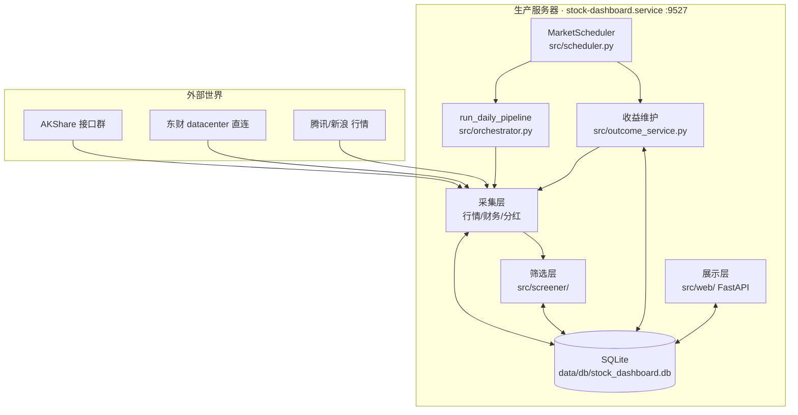

# Stock Dashboard — 系统架构

> 创建：2026-09-12 · 更新：2026-11-24（vendor v0.10.1 / 纸盘只读桥 E0 / 指数日更 / 消息面设计） · 地位：架构真相源（与 `iteration-log.md` 同级，`roadmap.md` 的上游依据）
> 改本系统前先读本文件。模块边界变更必须同步更新本文件 + 对应单测。

## 0. 术语表（开工前先读）

本仓文档、提交信息与 Issue 中使用若干口语简称。它们**不是**正式命名，正式名一律以下表为准。

| 口语简称 | 规范名 | 说明 |
|---|---|---|
| 账本 | `docs/iteration-log.md` | 迭代日志。提交信息中的基线数字（如「基线 768 passed」）记录在此 |
| 纸盘 | `paper-trading`（上游 `oldfunk/paper-trading`；本仓内为 `paper_trading/` 子树） | 模拟交易子项目。「纸盘」是行业既有口语（模拟盘，对「实盘」），非本仓独创 |
| 包工头 | 项目负责人（人） | 跨仓争议唯一裁决、决定 vendor 版本。见 `docs/subproject-protocol.md` §1 |
| 三表契约 | 子项目合并时的字段契约（子方「拥有 / 只读 / 永不碰」三类，见 `docs/subproject-protocol.md` §8） | **注意**：金融语境「三表」指资产负债表 / 利润表 / 现金流量表；此处是借用，语义完全不同。这里的「三」指**三类归属**，不是三张具体表；当前实例见 `paper_trading/MERGE_GUIDE.md` §2（拥有 `paper_account.db` / `data.db`；只读母库候选、观察池、快照、AI 历史等表；永不碰母库其余表） |

来源区分（避免误当成本仓独创术语）：

- `纸盘`、`账本` —— 行业既有词汇，被本仓借作昵称。
- `三表契约` —— 借金融术语「三表」作的比喻，**最易误读**。
- `包工头` —— 非金融术语，口语隐喻（建筑工种），指人。

## 1. 系统结构图

## 2. 每日数据流水线（15:30，工作日）

```mermaid
flowchart LR
    A[fetch_market_index<br/>大盘] --> B[fetch_all_stocks_basic<br/>~5500 A股行情]
    B --> C[pre_filter_stocks<br/>PE/PB/市值/ST 过滤]
    C --> D[enrich_financial_data<br/>yjbb + 摘要 + C2兜底]
    D --> E[stock_snapshot<br/>落库]
    E --> F[候选/钉选 enrich 回写<br/>+ S8 行业回填]
    F --> G[股息率回填<br/>+ 连续分红年数]
    G --> H[collect_historical_financial_data<br/>摘要+利润表+现金流+C2.5兜底]
    H --> I[rebuild_financial_summaries<br/>5y/10y 均值]
    I --> J{质量闸<br/>ROE覆盖≥50%}
    J -->|通过| K[run_screener<br/>7门 + 五维打分 Top20]
    J -->|不通过| Z[中断 + 告警]
    K --> L[screening_result 落库]
    L --> M[K线增量<br/>活跃池 + 全市场轮换]
    M --> N[market_state 日频快照]
    N --> O[AI 分析后台触发<br/>自带 Key + 队列]
```

实际顺序以 `src/orchestrator.py::run_collect_and_screen` + `src/scheduler.py::_check_daily_pipeline`
为准（上图 2026-11-19 按代码核对；括号内为失败语义）：

1. 采集：大盘指数、全市场行情、预过滤、财务增强、`stock_snapshot` 落库。
2. 候选回写 + 钉选补 enrich（钉选股被预过滤剔掉时单独拉一次腾讯行情）。
3. S8 行业回填（失败不清旧值）。
4. 股息率回填（年报分红 × 现价）；周六额外刷多年分红历史，再回填连续分红年数。
5. 历史财务增量 + 汇总重建（`financial_history` / `financial_summary`）。
6. 质量闸：候选 ROE 覆盖率 < 50% 则中止本次，保留上次结果。
7. 价值筛选（可选多策略三池并集），`screening_result` 落库。
8. K 线增量：活跃池 + 全市场轮换（失败不阻断后面的快照）。
9. `market_state` 日频快照（失败可 `backfill_market_state --force` 补算）。
10. AI 分析后台触发（`ai.enabled`，未配 Key 时落失败记录、不空转）。
11. 基准指数日线：东财优先/新浪回退，每交易日刷新（20:45 再兜底一次）——供 `/outcomes` 与子项目 CSI300 曲线/超额对照。

AI 分析用用户自带 Key（`/llm` 页配置 + 面板队列执行），面板只负责展示数据与 AI 笔记、列表卡片不再内联 AI 分析。周六复盘由 `WatchlistReviewer.review()` 触发（定时节奏见 `ai_review.days/time`，默认周六 00:00；硬规则 + 监控条件本地执行；LLM 决议走用户 Key → `ai_watchlist` / `ai_journal`）。

2026-10-21 起，采集流水线在财务增强前 `ensure_dividend_data`（7 天缓存），增强后 `attach_dividends` 计算股息率/分红率并随快照/筛选结果落库。

**周六维护班车**（`src/scheduler.py::_run_weekly_refresh`，`outcomes.refresh_time` 默认 09:00）顺序固定：
分红 → 交易日历未来段 → **qfq 锚点重锚** → 基准日线 + 前向收益 → 深层字段全量（ic/EM）。
顺序原因：分红会移动复权锚点；前向收益算出即冻结，必须在重锚之后；深层字段最贵放最后。
执行在后台线程，不阻塞实时行情与当日 15:30 流水线的时点判定。

## 3. 模块边界（跨层调用禁令）

| 模块 | 职责 | 允许调用 | 禁止 |
|---|---|---|---|
| `collector/` | 原始数据抓取 + 落库前清洗 | `models/`（DAO） | 不得做打分/决策；不得直写展示字段 |
| `screener/` | 7 门 + 豁免 + 五维打分 | `models/`（只读 summary/snapshot） | 不得调 AKShare；不得调 LLM |
| `analyzer/` | 本地分析（pipeline 已停用触发；手动脚本可用） | `models/` | 不得被 pipeline 调用 LLM |
| `scheduler.py` | 定时触发 + 并发 guard | `orchestrator` | 不得含业务逻辑（只做触发 + 防重入）；不得触发本地 AI 分析 |
| `orchestrator.py` | 流水线编排 + 锁 | 各层入口函数 | 不得含采集/打分细节 |
| `outcome_service.py` | 基准/K线刷新 + 前向收益落库 | `collector/` + `analyzer/outcomes` + `models/` | 不做交易、不改筛选、不发通知 |
| `web/routes.py` | 读库 + enrich + 渲染 | DAO + `_enrich_stocks()` | 不得调 AKShare/LLM（`onboard` 后台线程除外）；列表卡片不得内联 AI 分析 |
| `paper_trading/` | 子项目全量合并树（subtree 机制，vendored **v0.10.1**（2026-11-24 合流；含母策略 PR #6 / T96 计划新鲜度 / 面板 P2 / daily-check / :8081 方案免口令与 intents 降级）；单向 tag 流；规则引擎/条件单/AI 交易员/回测纪律等见子项目 README），原生页面独立运行；母侧实例的九条 cron 与运行窗口见 §9.7 | 母库只读（screening/watchlist/快照/AI 历史/笔记/论文）、我们的 LLM Key | vendored 运行 CWD 须为该目录；上游漂移则以后 pull 冲突 |

## 4. 数据表清单（现状）

> 2026-11-19 按生产库 `sqlite_master` 全量核对（**48 张**）。**0 行的表是"脚手架已建、尚未启用"，
> 不要当成已上线能力**；行数随时间变化，以库为准。

### 4.1 行情与基础主数据

| 表 | 写者 | 读者 | 说明 |
|---|---|---|---|
| `market_index` | 采集 | 首页 | 大盘指数，保留 30 天 |
| `stock_snapshot` | 采集/onboard | 全站 | 当日快照：行情 + 基础财务 + 股息字段（NULL=缺数据）；**只支持当日**——每日覆盖写、不保留历史截面（2026-10-29 P0-3 用户拍板 b），历史状态向量走 `market_state_daily`（F6 逐 code PIT），需要逐股历史截面时再议版本化。**行业契约（2026-11-21）**：`sector` 来自 S8 新浪 49 板块（`次新股` 是源分类，原样展示）；某标的当次缺失就留 NULL，**不回退旧值**（子项目按"未知"展示）；`snapshot_date` 每交易日覆盖更新。 |
| `daily_close` | 采集（覆盖层） | market_state 广度/估值分位 | 全市场当日收盘覆盖层；**不复权，只有 close/amount/volume**——填不了 `kline_daily` 的 OHLC/复权列（所以"当日 K 线"仍可能滞后一天，见上游 paper-trading#5）；腾讯当日 bar 晚于 15:30 的部分由次日自愈 |
| `kline_daily` | 调度/回填 | K 线图/估值分位/回测 | 日 K；四列价格 `close_raw`（不复权，估值）/`close_adj`（后复权，回测）/`close_qfq`（前复权，子项目契约）/`close`（展示，= `close_qfq`）+ `shares`（每日流通股本） |
| `trading_calendar` | 周六维护（S15） | 调度/子项目契约/T+1 | 历史尾部 + 未来交易日；**源覆盖到哪写到哪**，覆盖外不臆造（子项目 fail-closed 依赖） |
| `benchmark_daily` | 收益维护（每交易日 + 20:45 兜底） | `/outcomes`、子项目 | 基准指数日线；**代码约定**：`sh000300`/`sh000922`（收益验证用）+ `000001`/`399001`/`399006`（子项目约定，上证综指/深证成指/创业板指）；价格指数、不复权 |
| `instrument` | 初始化/迁移 | 研究 OS/回测 | 证券主数据（`instrument_id`，2026-10-26 迁移后 0 空值） |
| `market` | 迁移 | 研究 OS | 市场主数据（A 股 = 1 行） |
| `data_quality_daily` | 数据体检 | 运维 | 每日数据质量结论 |

### 4.2 财务与分红

| 表 | 写者 | 读者 | 说明 |
|---|---|---|---|
| `financial_history` | 采集/回填（S11–S13 + mainfin） | 汇总重建/详情页/估值/回测 | 年报明细；含 `notice_date`（防前视）；全市场回填已收官，余量是上游真无 |
| `financial_summary` | 重建 | 筛选/详情页 | 5y/10y 均值（ROE/毛利/FCF/ROIC…） |
| `dividend_annual` | 股息维护（S9） | 筛选/快照/AI prompt | 年报现金分红；每股/股息率/分红率，缺数据 NULL |

### 4.3 候选、分析与笔记

| 表 | 写者 | 读者 | 说明 |
|---|---|---|---|
| `screening_result` | 筛选 | 候选页/池 | 每轮 Top + AI 分析回写 + 策略标签/股息字段 |
| `stock_analysis_history` | 自带 Key 分析 + 外部写回兼容 | 时间线/复盘 | 每次 AI 分析快照 |
| `ai_analysis_log` | 自带 Key 分析（用量记账） + 外部写回兼容 | 成本统计 | token 用量 |
| `ai_watchlist` | 周复盘 | 首页 | 当前观察池 |
| `ai_watchlist_history` | 周复盘 | 变更追踪 | 每次调仓记录 |
| `ai_journal` | 周复盘 | 笔记页 | 复盘纪要 |
| `watchlist` | 用户钉选 | 钉选 tab | 用户手工池 |
| `watchlist_notes` | 用户/面板 | 钉选 tab | 钉选笔记（表已建，当前 0 行） |
| `watchlist_thesis` | 周复盘/面板 | 钉选 tab | 钉选论点（持久，当前 24 行） |
| `news_item` / `news_digest` / `news_fetch_log` | 新闻采集/摘要 | 首页滚动条/笔记页/调度冷却 | URL+标题幂等；市场级伪代码 `__market__` |
| `analysis_outcome` | 收益维护 | `/outcomes` | 每条有 Signal 分析 × 基准 × horizon 的前向收益；非空后冻结 |

### 4.4 研究 OS（判据链）

| 表 | 说明 |
|---|---|
| `research_hypothesis` / `research_experiment` / `research_result` | 预注册假设、实验定义、结论与 `splits_json`（每桶带 `{mean,n}`） |
| `market_state_daily` | 日频市场状态向量（F2/F6；`pe_percentile_5y` 尚有缺口） |
| `feature_definition` / `stock_feature_daily` / `universe_membership` | 特征与股票池脚手架（当前 0 行） |
| `llm_task` / `llm_run` / `prompt_registry` | 研究线 LLM 任务/运行/提示词登记（当前 0 行） |
| `fx_rate_daily` | 汇率日频（研究 OS 脚手架，当前 0 行） |
| `decision_log` / `strategy_version` / `strategy_deployment` / `strategy_attribution` | 策略与决策脚手架（当前 0 行） |

### 4.5 运维与进度

| 表 | 写者 | 读者 | 说明 |
|---|---|---|---|
| `run_log` | 编排 | 状态栏 | 每轮运行状态（当日失败按最新 running 归属，避免记到僵尸 run） |
| `pipeline_progress` | 编排 | 面板进度条 | 采集/筛选/AI 的实时进度 |
| `backfill_progress` | 回填脚本 | 回填脚本 / `audit_no_data` | `(task, code)` 进度 + `covered_report_date`；断点续跑/重试；`task` 决定 no_data 语义 |

### 4.6 遗留（勿用）

| 表 | 状态 |
|---|---|
| `paper_account` / `paper_nav` / `paper_orders` / `paper_positions` / `paper_trades` | M4a 自研虚拟盘遗留，**0 行**；现行纸盘在 `paper_trading/` 的独立库（`paper_account.db` / `data.db`），与本库无关 |
| `deep_research` | 2026-09-23 用户批准删除，5 行已备份，勿重建 |

## 5. 数据源适配层规范（防 AKShare 式遗失）

> 事故教训：`stock_profit_sheet_by_report_em` / `stock_cash_flow_sheet_by_report_em` 在迭代中静默失效（`'NoneType' object is not subscriptable`），历史原因是"换了写法，旧兜底被删"。根治办法不是记住，而是让删除变得不可能不被发现。

### 5.1 Source Registry（注册表）

`src/collector/` 内的数据源必须在此登记，缺一不可：

| # | 数据源 | 函数 | 状态 | 兜底链 |
|---|---|---|---|---|
| S1 | 腾讯批量行情 | `fetch_tencent_batch` | 主用 | 新浪 → AKShare + 自算 |
| S2 | 业绩报表 | `stock_yjbb_em` 经 `_find_latest_yjbb_date` | 主用 | C2 东财直连 `_fetch_eastmoney_direct` |
| S3 | 财务摘要 | `stock_financial_abstract_ths`（并发+7天缓存） | 主用 | 无（失败即缺数，`onboard` 重试） |
| S4 | 利润表 | `stock_profit_sheet_by_report_em` | **已挂** | C2.5 东财 `_fetch_eastmoney_roic_fcf` |
| S5 | 现金流表 | `stock_cash_flow_sheet_by_report_em` | **已挂** | C2.5 东财 `_fetch_eastmoney_roic_fcf` |
| S6 | 个股 K 线 | `fetch_kline_data` | 主用 | 东财→腾讯回退 |
| S7 | 实时 tick（调度缓存） | `_poll_stocks` → `_realtime_cache` | 主用 | `fetch_stock_realtime` 按需拉 |
| S8 | 行业分类（新浪 49 板块） | 新浪直连 `newSinaHy` + `getHQNodeData`（`_fetch_sector_map_impl`） | 主用 | 上次成功磁盘缓存 → `{}` 跳过回填（不清旧值） |
| S9 | 年报分红 | `stock_fhps_em` 经 `dividend_fetcher.refresh_dividends` | 主用 | 无（失败保留旧数据；红利策略 fail-closed） |
| S10 | 指数日线（基准） | `stock_zh_index_daily_em` 经 `fetch_index_kline_em` | 主用 | 新浪 `stock_zh_index_daily`（sh000922 只到 2019-01-30） |
| S11 | 主要财务指标（年报） | `fetch_mainfin_annual`（东财 `RPT_F10_FINANCE_MAINFINADATA`） | 主用 | 无（失败保持 NULL；回填可重试） |
| S12 | 资产负债表（年报） | `fetch_balance_sheet_annual`（东财 F10 `zcfzb*`） | 主用 | 无（BOM/HTML 已重试） |
| S13 | 现金流量表（年报） | `fetch_cash_flow_annual`（东财 F10 `xjllb*`） | 主用 | 无（同上） |
| S14 | 历史日线全量（回填） | `ak.stock_zh_a_daily`（Sina，不复权+后复权） | 回填主用 | 东财 `push2his`（约 35 次限流）→ 腾讯 `fqkline`（慢/负价） |
| S15 | 交易日历（历史+未来） | `ak.tool_trade_date_hist_sina` 经 `fetch_trade_calendar` | 主用 | 无（失败回 `[]`，日历未来段不写行；覆盖末端之外不臆造日期） |

> S9 在 `src/collector/dividend_fetcher.py`，S10/S15 在 `src/collector/akshare_fetcher.py`；两者同受本节三条铁律约束。
> S15 源覆盖有限（2026-10 实测到 2026-12-31；交易所年度休市安排发布后才延长，2027 年安排往年约 12-22 发布）——
> `scripts/fix_price_contract.backfill_trading_calendar` 只写源覆盖范围内日期，调度器每周六重跑自动接上更远日期。

### 5.2 三条铁律

1. **删适配函数 = 删注册表行 + 删契约单测，三者同 commit，缺一驳回。** 自动迭代触碰 `collector/` 时必须先读本节。
2. **每个 S# 必须有一个 mock 契约单测**（不断网可跑）：断言返回字段集合不变。字段增减必须同步改注册表 + 下游（screener/prompt/模板）。
3. **新增数据源先登记 S# 再写代码**，兜底链写明"无"时必须给出重试/降级策略（参考 `onboard_stock` 三段降级）。

### 5.3 回归门禁（合并前必查）

- 全仓 `pytest` 零失败；下限以 `scripts/gate-baseline.txt`（母项目）/ `scripts/gate-baseline-vendor.txt`（vendor）为准，**只升不降**，由 `gate.sh` 自动强制（本机不跑 pytest，全仓验证在生产机）。当前值（2026-11-24）：母 **1522**、vendor **996**——本条不复制数字为准，改基线时以文件为准。
- `collector/` / `screener/` 任一改动必须附带单测。
- 破坏性变更三问（写进 commit message）：删了哪个 S#？兜底是否覆盖？契约单测是否同步？
- 生产服务器只接受 `main` 分支部署；开发侧只提交 GitHub，不直连生产改动（生产从 origin 拉取，见 iteration-log 约束）。

### 5.4 回填限速（2026-10-26 实测）

| 源 | 实测限制 | 策略 |
|---|---|---|
| 东财 `push2his` | 单请求正常，约 **35 次快速请求后限流**（rc=56/000） | 历史价格回填不用它做主源；保留为备选，失败指数退避 |
| 腾讯 `fqkline` | 无频率问题，但 **约 38s/只**（5 页×7s），高分红长历史为负价 | 仅备选 |
| Sina `stock_zh_a_daily` | raw/hfq 各一次，3–5s，全历史+每日股本 | **历史价格回填主源**；`--sleep 0.5` |
| 东财 F10（S11–S13） | 3 类请求/只，约 5–8s/只 | 年报回填 `--sleep 0.4`，单实例锁 |

所有回填脚本共用规则：单实例锁、`backfill_progress` 断点续跑、失败记 `partial` 可重试、禁止并发多实例抢同一上游。

## 6. 架构演进方向

- **P1 面板深化**：✅ 收尾（评分透明化 / AI 笔记增强 / 时间线交互 / 详情页体验均已完成）
- **P2 体验优化**：⛔ 冻结（2026-09-23 维护模式归档，移动端/快捷切换/指标高亮/搜索排序不再投入）
- **AI 分析**：用用户自带 Key（`/llm` 配置 + 队列执行），面板只负责展示数据与 AI 笔记
- **本地分析代码**：`src/analyzer/` 保留（pipeline 不再触发，仅手动脚本可用）；`src/paper/`（M4a 自研虚拟盘）已删除
- **量化交易系统**：M4a/原生包已归档；2026-09-29 起由 M6 全量合并接替（顶层 `paper_trading/` + `/paper` 嵌原面板；Universe 走母筛选 + AI 用我们的 Key；:8081 面板独立服务，运行契约见 §9.7）
- **研究分析层（2026-10-26 起，11 月扩展为判据链）**：SQLite 业务事实源 + Parquet 研究快照 + DuckDB 嵌入式分析；不引入数据库服务；判据链（预注册 → CI 规则 → Bonferroni → 参数敏感性 → 结论）落在 `src/research/`。详见 `docs/research-os.md` §19–20。

## 7. 方法论与内化避坑（2026-09-22 定稿）

门规、豁免、五维评分、分析纪律均为本项目自有实现（价值投资通用原则的本地化）。

**两阶段方向相反是分工，不是矛盾**：筛选是漏斗，宁可漏网不可误杀；决策是闸门，宁可错过不可做错。两处规则必须保持口径分离，不得互相"修正"。

**内化避坑清单（硬约束）**：
1. 禁止硬编码倍数评分表（如"ROE>15% 优秀/20% 卓越"式查表打分）——评分用连续分制，阈值只做门规与豁免判断
2. 禁止多 agent 角色扮演"独立视角"——同源模型互相当独立视角是假验证；分析采用单 prompt 结构化输出
3. 每条豁免写成通用条件组合，禁止绑定明星案例（美团/亚马逊/Costco 式锚定不得进规则）
4. 数据源规范只写适配器接口与验收（见 §5），不写死上游 URL 清单
5. 结构化输出模板必须配"具体结论而非空话"要求（假设须带验证方式与频率，触发红线须给证据），防止填空式八股
6. 一切分析落库（论文/假设状态/复盘笔记），禁止"生成 .md 即终点"的一次性报告
7. 输出格式禁装饰性要求（"呼应大师名言"式），只允许信息性结构
8. prompt 每个关键输入附来源与 asof 日期，缺失/兜底字段显式标注（见 `_data_quality_*`），不得当精确值引用

**已内化的对照能力**（均在本仓实现，无外部依赖）：门规+豁免+五维评分（`src/screener/value_screener.py`）、估值/终值验算闸（`scripts/verify_valuation.py` / `verify_intrinsic.py`）、双源误差标记进 AI 数据质量（`_attach_batch_context` + `_data_quality_text`）、六关 Checklist+镜子测试+否决红线+反面检验（`ANALYSIS_PROMPT`）、论文假设追踪与复盘写回（`watchlist_thesis` 表 + `WatchlistThesisDAO` + 复盘 `thesis_updates`）、周复盘三问（`_build_prompt`）。

## 8. UI 指标与卡片单一事实源（2026-10-26）

> 背景：同一组个股指标曾在 5 个表面各写一遍（候选卡模板、AI 观察池模板、手动钉选 JS、个股详情、观察池详情），标签/格式/阈值/缺值行为持续漂移；股息率只是最近一次暴露。

- **指标定义**：`src/web/stock_metrics.py` 的 `CARD_METRICS` 是唯一来源（key/标签/格式/好中差阈值/tooltip）；负 PE/PB 判 bad，缺失统一 `--`。
- **指标渲染**：`src/web/templates/_metric_cells.html` 是唯一片段，`variant=card|wl|sd|wd` 控制外壳。
- **个股卡**：`src/web/templates/_stock_card.html` 是唯一模板；候选/AI 观察池/钉选三视图共用，只允许徽标（池 N 周/加入于/信号）与按钮状态不同。钉选卡由 `/api/watchlist/cards` 服务端渲染，JS 只注入 HTML。
- **详情页**：`stock_detail.html` / `watchlist_detail.html` 也 include `_metric_cells.html`，并与卡片共用同一组指标。
- **静态资源**：`static_url()` 按文件 mtime 自动加 `?v=`，禁止手写日期戳。
- **防回潮**：`tests/web/test_ui_metric_parity.py` 强制三卡标签/值/缺值一致、详情页同口径、模板禁止再手写指标标签、静态版本自动生成。
- **数据/运行源**：`RunLogDAO.get_latest_run()` 排除 `_review`，首页"上次运行/候选数"不再被周六复盘轮顶掉。

## 9. 价格模型 / 主键 / 子项目数据契约（2026-10-27）

> 背景：子项目 `paper-trading`（本仓 vendored **v0.10.1**；下列契约自 v0.7.2 起沿用）执行侧已切"母库优先"（`config.data.daily_source=auto`），
> 只读母库 SQLite（`mode=ro`），缺标的回退本地 akshare 前复权日线。以下契约来自子项目 Issue #4–#8。

### 9.1 复权口径（`kline_daily`）

| 列 | 口径 | 用途 |
|---|---|---|
| `close_raw` | 不复权收盘 | 估值（PE/PB 与当期 EPS/BVPS 同口径） |
| `close_adj` | **后复权**收盘（恒正） | 回测总收益 |
| `close_qfq` | **前复权**收盘 | 子项目契约（与其本地 akshare qfq 同口径） |
| `close` | 展示列 = `close_qfq` | 页面展示 |

- 换算：`close_qfq = close_adj × (close_raw_last / close_adj_last)`（每股一个常数缩放）。
- 源：Sina `stock_zh_a_daily`（不复权 + 后复权各一次）；东财/腾讯为备选。
- **契约保证**：`close_adj` 非空（stub 行已重抓补齐）；`close_qfq` 非空。

### 9.2 主键与 instrument 约定

- `kline_daily` 主键仍为 `(code, trade_date)`（**不改**，避免 215 万行重建）。
- `market`（`CN`/`HK`/`US`）+ `instrument_id`（`CN:600519`）为多市场维度，索引 `(instrument_id, trade_date)`。
- 子项目按 `code` 查询继续可用；新市场用 `instrument_id`。

### 9.3 基准指数代码

- `benchmark_daily.code`：`sh000300`/`sh000922`（收益验证）+ `000001`/`399001`/`399006`（子项目约定：上证综指/深证成指/创业板指）。
  **两套键并存、不可统一**：前两个带前缀（配置键），后三个是子项目契约裸码（Issue #5/#10）；
  拉取符号分别是 `sh000300`/`sh000922`/`sh000001`/`sz399001`/`sz399006`。
- `market_index.index_code` 同时存在 `sh/sz` 前缀与纯数字两种写法。
- **口径**：指数收盘是**价格指数、不复权**；`close` 为当日收盘，东财优先、新浪回退（`sh000922` 新浪只到 2019，必须东财）。
- **新鲜度（2026-11-21 起）**：每日 15:30 流水线结束后随 `refresh_benchmarks` 更新一次（原仅周六维护，实测会 stale 一周）；
  发布时点按源，15:30 后当日收盘可用；失败只告警，不阻断流水线。
- 契约测试：`tests/analyzer/test_benchmark_codes_20261029.py` 锁定规范化与契约裸码并入。

### 9.4 交易日历

- `trading_calendar(market_id, trade_date, is_open)`：
  - 历史（≤ kline 最新日）：由 `kline_daily` 交易日回填（`is_open=1`，`source=kline_daily`），区间内其余自然日 `is_open=0`。
  - 未来（kline 最新日之后）：按新浪交易日历源（S15）覆盖范围写入（`source=sina_trade_date_hist`）——源内交易日 `is_open=1`、覆盖区间内周末/休市 `is_open=0`；**源未覆盖的日期不写任何行**（fail-closed，不臆造；2027 年休市安排发布前覆盖到 2026-12-31）。
  - 维护：`scripts/fix_price_contract.backfill_trading_calendar` 幂等，调度器每周六随周维护重跑；源延长（如 2027 安排发布）后下一次运行自动跟上。
  - 子项目侧：`max(is_open=1 日期) >= 今天` 才采用母库日历，否则回退 akshare（v0.7.4 fail-closed 防护）。

### 9.5 覆盖度

- `GET /api/data/coverage`：`kline_codes / instruments / price_done / coverage` + `codes_with_null_close_adj`。
- 回填进度见 `backfill_progress`（`task=price_history`）。

### 9.6 子项目调阅接口（只读）

- `/api/data/screening` `/watchlist` `/stock/{code}` `/universe/search` `/universe/size`
- `/api/data/market_state` `/market_index` `/outcomes`
- `/api/data/benchmark` `/benchmark/{code}` `/calendar` `/coverage`
- `/api/data/research/hypotheses|experiments|decisions|market_states`
- `/api/paper/status|nav|fills`（母站读纸盘账本，E1；块级降级）
- 原则：只读、稳定 JSON 契约、缺失不抛错（子项目可静默回退）。

### 9.7 母侧实例（:8081）的运行契约（2026-11-19 补；2026-11-24 扩为 7 条）

母树里的 `paper_trading/` 不是"只有面板"：AI 交易员靠 **三条交易 cron + 两条 raw 拉取 + 两条收盘兜底 + 两条 K 线二次拉取** 驱动，
缺一条就会静默停摆（2026-10-23→11-19 实证：面板 200，`agent_plans` 停在 10-26
pending、三周零流水）。任务、命令与路径的真相源是
`scripts/install_mother_agent_cron.sh`（幂等安装 + `--check` 核对）：

| 时间 | 任务 | 作用 |
|---|---|---|
| 工作日 09:30–10:00 每 5 分 | `agent tick` | 只执行当天 pending 计划；无计划静默，不临时问模型 |
| 工作日 16:30–18:30 每 5 分 | `agent tick` | 数据定稿到今天后做**下一交易日**计划，成功后幂等停止 |
| 周六 10:00 | `calendar sync` | 交易日历（母库 `trading_calendar` 优先），未覆盖的日期 fail-closed |
| 工作日 15:50 | `scripts/fetch_mother_raw.sh` | 拉当日 **raw 收盘**（持仓），供 16:30 计划窗口写 NAV |
| 工作日 20:40 | 同上 | 源晚发布时兜底（NAV 只认 raw，见 issue paper-trading#7） |
| 工作日 20:45 | `scripts/refresh_benchmarks.py` | 指数日线兜底：16:00 首刷常遇东财断连/新浪未发布（2026-11-23 实测） |
| 工作日 20:50 | `scripts/nav_close_mother.py` | 16:30 因 raw 未入库跳过时，用 20:40 的 raw 补写当日 NAV（幂等） |
| 工作日 17:05 | `scripts/refresh_kline_pool.py` | 二次拉取持仓+候选 Top20 的完整 OHLC，保 T96 计划窗口当日覆盖 |
| 工作日 17:35 | 同上 | 源晚发布时兜底（16:30–18:30 窗口内后续 tick 可用） |

- 命令固定 `--scheme mother --pool-from screening --pool-limit 15`，CWD 必须是
  `paper_trading/`（相对路径 `data.db`/`paper_account.db`/`var/`/`logs/` 都相对 CWD）。
- `engine.enabled=false` 是发布默认：母侧路线是"收盘计划 + 开盘执行"一日一决策，
  不跑盘中规则引擎/条件单成交；独立版 :8080 的 cron 与此互不影响。
- **策略口径（2026-11-19 起，热修已部署）**：母方案的参考信号与买入闸门取自母项目
  `screening_result.ai_trade_strategy`（signal / buy_zone / stop_loss）；没有分析、分析
  过期（>3 天）、signal 非 BUY、现价不在买入区间 → **拒绝买入**（代码层 fail-closed，
  拒因进 `ai:decide`）。不再使用 MA 信号；卖出不受闸门限制。上游 PR paper-trading#6。
- 两条实例共用母库只读接口，但**账户、DB、var、日志各自独立**；改动任一侧不得改另一侧。
- 验收：`bash scripts/install_mother_agent_cron.sh --check` 退出 0；`python scripts/check_paper_agent.py`
  退出 0（收盘窗口后要求下一交易日有计划、开盘窗口后要求当天计划已 `done`，休市日只查 cron）；
  `logs/agent.log` 在计划窗口出现 tick 流水；`agent_plans` 出现目标日为下一交易日的 pending 行。

## 10. 新闻与收盘检阅（F 线，2026-11-28）

- **采集**：`src/collector/news_fetcher.py` 源注册表。个股 `akshare_em`；市场级
  `caixin_hot / cls_telegraph / em_global / sina_global / ths_global / futu_global`。
  默认启用前四个；市场级单源 20 条、合并去重后单轮 ≤40（`news.market_total`）。
- **入库**：`news_item`（UNIQUE(url,title)）；实体/聚类/级别回写
  `entities_json/cluster_id/severity/event_type/official`。
- **收盘检阅**：`src/news_review/`（rules/facts/prompt/pipeline）→ `ai_journal`
  （`note_type=close_review`，`status=published|annotated`）。事实来自行情库与纸盘桥，
  新闻事实必须 `[news#id]`；市场/组合事实不带新闻引用；交易建议句发布前删除。
- **事件**：`news_event`（P0 政策/监管、P1 公司重大、30 分钟冷却、P0≤5/P1≤10），
  规则先行，只落库/提醒，**不触发交易**，P0/P1 只进下一计划窗口复核清单。
- **调度**：进程内 scheduler，15:45 首跑、18:30 重试（`news.review_*`）；
  盘中 09:30–15:05 每 10 分钟扫一次事件（`news.event_*`）。不是 crontab 任务。
- **面板**：首页"收盘检阅"卡（最新一篇 + 今日 P0/P1）、`/news` 页（检阅/事件/最新新闻）、
  `/journal/{date}` 全文、`/performance`（纸盘 vs 基准 + 信号前向收益）；
  API `/api/news/review/*`、`/api/news/events`、`/api/performance`。
- **口径**：新闻不进入纸盘策略；NAV/成交按笔记日期截断（历史回填不偷看未来）；
  无新闻是合法输出，失败降级为确定性摘要并标 `degraded`。
