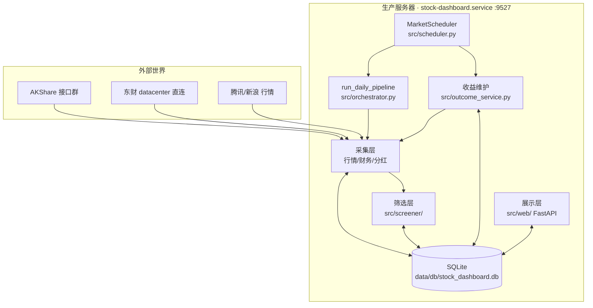

# Stock Dashboard — 系统架构

> 创建：2026-09-12 · 更新：2026-10-26（价格三列 / 全市场年报回填 / UI 单一事实源） · 地位：架构真相源（与 `iteration-log.md` 同级，`roadmap.md` 的上游依据）
> 改本系统前先读本文件。模块边界变更必须同步更新本文件 + 对应单测。

## 0. 术语表（开工前先读）

本仓文档、提交信息与 Issue 中使用若干口语简称。它们**不是**正式命名，正式名一律以下表为准。

| 口语简称 | 规范名 | 说明 |
|---|---|---|
| 账本 | `docs/iteration-log.md` | 迭代日志。提交信息中的基线数字（如「基线 768 passed」）记录在此 |
| 纸盘 | `paper-trading`（上游 `oldfunk/paper-trading`；本仓内为 `paper_trading/` 子树） | 模拟交易子项目。「纸盘」是行业既有口语（模拟盘，对「实盘」），非本仓独创 |
| 包工头 | 项目负责人（人） | 跨仓争议唯一裁决、决定 vendor 版本。见 `docs/subproject-protocol.md` §1 |
| 三表契约 | 子项目合并时的字段契约（子方「拥有 / 只读 / 永不碰」三类，见 `docs/subproject-protocol.md` §8） | **注意**：金融语境「三表」指资产负债表 / 利润表 / 现金流量表；此处是借用，语义完全不同。这里的「三」指**三类归属**，不是三张具体表；当前实例见 `paper_trading/MERGE_GUIDE.md` §2（拥有 `paper_account.db` / `data.db`；只读母库候选、观察池、快照、AI 历史等表；永不碰母库其余表） |

来源区分（避免误当成本仓独创术语）：

- `纸盘`、`账本` —— 行业既有词汇，被本仓借作昵称。
- `三表契约` —— 借金融术语「三表」作的比喻，**最易误读**。
- `包工头` —— 非金融术语，口语隐喻（建筑工种），指人。

## 1. 系统结构图

## 2. 每日数据流水线（15:30，工作日）

```mermaid
flowchart LR
    A[fetch_market_index<br/>大盘] --> B[fetch_all_stocks_basic<br/>~5500 A股行情]
    B --> C[pre_filter_stocks<br/>PE/PB/市值/ST 过滤]
    C --> D[enrich_financial_data<br/>yjbb + 摘要 + C2兜底]
    D --> E[stock_snapshot<br/>落库]
    E --> F[collect_historical_financial_data<br/>摘要+利润表+现金流+C2.5兜底]
    F --> G[financial_history 落库]
    G --> H[rebuild_financial_summaries<br/>5y/10y 均值]
    H --> I[financial_summary 落库]
    I --> J{质量闸<br/>ROE覆盖≥50%}
    J -->|通过| K[run_screener<br/>7门 + 五维打分 Top20]
    J -->|不通过| Z[中断 + 告警]
    K --> L[screening_result 落库]
    L --> N[K线拉取<br/>池 + Top25]
```

AI 分析用用户自带 Key（`/llm` 页配置 + 面板队列执行），面板只负责展示数据与 AI 笔记、列表卡片不再内联 AI 分析。周六复盘由 `WatchlistReviewer.review()` 触发（定时节奏见 `ai_review.days/time`，默认周六 00:00；硬规则 + 监控条件本地执行；LLM 决议走用户 Key → `ai_watchlist` / `ai_journal`）。

2026-10-21 起，采集流水线在财务增强前 `ensure_dividend_data`（7 天缓存），增强后 `attach_dividends` 计算股息率/分红率并随快照/筛选结果落库；周六 09:00 另跑股息 + 基准 + 前向收益维护（`src/outcome_service.py`，默认 `outcomes.refresh_weekday=5` / `refresh_time=09:00`）。

## 3. 模块边界（跨层调用禁令）

| 模块 | 职责 | 允许调用 | 禁止 |
|---|---|---|---|
| `collector/` | 原始数据抓取 + 落库前清洗 | `models/`（DAO） | 不得做打分/决策；不得直写展示字段 |
| `screener/` | 7 门 + 豁免 + 五维打分 | `models/`（只读 summary/snapshot） | 不得调 AKShare；不得调 LLM |
| `analyzer/` | 本地分析（pipeline 已停用触发；手动脚本可用） | `models/` | 不得被 pipeline 调用 LLM |
| `scheduler.py` | 定时触发 + 并发 guard | `orchestrator` | 不得含业务逻辑（只做触发 + 防重入）；不得触发本地 AI 分析 |
| `orchestrator.py` | 流水线编排 + 锁 | 各层入口函数 | 不得含采集/打分细节 |
| `outcome_service.py` | 基准/K线刷新 + 前向收益落库 | `collector/` + `analyzer/outcomes` + `models/` | 不做交易、不改筛选、不发通知 |
| `web/routes.py` | 读库 + enrich + 渲染 | DAO + `_enrich_stocks()` | 不得调 AKShare/LLM（`onboard` 后台线程除外）；列表卡片不得内联 AI 分析 |
| `paper_trading/` | 子项目全量合并树（subtree 机制，vendored v0.6.5，原生页面独立运行；v0.6.7 待子方修 Issue #1 后再 vendor） | 母库只读（screening/watchlist/快照/AI 历史/笔记/论文）、我们的 LLM Key | vendored 运行 CWD 须为该目录；上游漂移则以后 pull 冲突 |

## 4. 数据表清单（现状）

| 表 | 写者 | 读者 | 说明 |
|---|---|---|---|
| `market_index` | 采集 | 首页 | 大盘指数，保留 30 天 |
| `stock_snapshot` | 采集/onboard | 全站 | 当日快照：行情 + 基础财务 + 股息字段（NULL=缺数据） |
| `financial_history` | 采集/回填 | 汇总重建/详情页/估值/回测 | 年报明细；全市场回填进行中（2026-10-26 起） |
| `financial_summary` | 重建 | 筛选/详情页 | 5y/10y 均值（ROE/毛利/FCF/ROIC…） |
| `screening_result` | 筛选 | 候选页/池 | 每轮 Top + AI 分析回写 + 策略标签/股息字段 |
| `stock_analysis_history` | 自带 Key 分析 + 外部写回兼容 | 时间线/复盘 | 每次 AI 分析快照 |
| `ai_analysis_log` | 自带 Key 分析（用量记账） + 外部写回兼容 | 成本统计 | token 用量 |
| `ai_watchlist` | 周复盘 | 首页 | 当前 5 只池股 |
| `ai_watchlist_history` | 周复盘 | 变更追踪 | 每次调仓记录 |
| `ai_journal` | 周复盘 | 笔记页 | 复盘纪要 |
| `news_item` | 新闻采集 | 首页滚动条 | 个股/市场新闻，URL+标题幂等 |
| `news_digest` | 新闻摘要 | 笔记页 | 每日 AI 日报，与复盘分开 |
| `news_fetch_log` | 新闻采集 | 调度冷却 | 抓取尝试记录（含市场级伪代码 `__market__`） |
| `watchlist` | 用户钉选 | 钉选 tab | 用户手工池 |
| `kline_daily` | 调度/回填 | K 线图/估值分位/回测 | 日 K；四列价格 `close_raw`（不复权，估值）/`close_adj`（后复权，回测）/`close_qfq`（前复权，子项目契约）/`close`（展示，= `close_qfq`）+ `shares`（每日流通股本） |
| `backfill_progress` | 回填脚本 | 回填脚本 | `(task, code)` 进度 + `covered_report_date`；断点续跑/重试 |
| `benchmark_daily` | 收益维护 | `/outcomes`、子项目 | 基准指数日线；**代码约定**：`sh000300`/`sh000922`（收益验证用）+ `000001`/`399001`/`399006`（子项目约定，上证综指/深证成指/创业板指）；价格指数 |
| `dividend_annual` | 股息维护 | 筛选/快照/AI prompt | 年报现金分红；每股/股息率/分红率，缺数据 NULL |
| `analysis_outcome` | 收益维护 | `/outcomes` | 每条有 Signal 分析 × 基准 × horizon 的前向收益；非空后冻结 |
| `run_log` | 编排 | 状态栏 | 每轮运行状态 |
| `deep_research` | —（已删除） | 无 | 2026-09-23 用户批准删除，5 行已备份，勿重建 |

## 5. 数据源适配层规范（防 AKShare 式遗失）

> 事故教训：`stock_profit_sheet_by_report_em` / `stock_cash_flow_sheet_by_report_em` 在迭代中静默失效（`'NoneType' object is not subscriptable`），历史原因是"换了写法，旧兜底被删"。根治办法不是记住，而是让删除变得不可能不被发现。

### 5.1 Source Registry（注册表）

`src/collector/` 内的数据源必须在此登记，缺一不可：

| # | 数据源 | 函数 | 状态 | 兜底链 |
|---|---|---|---|---|
| S1 | 腾讯批量行情 | `fetch_tencent_batch` | 主用 | 新浪 → AKShare + 自算 |
| S2 | 业绩报表 | `stock_yjbb_em` 经 `_find_latest_yjbb_date` | 主用 | C2 东财直连 `_fetch_eastmoney_direct` |
| S3 | 财务摘要 | `stock_financial_abstract_ths`（并发+7天缓存） | 主用 | 无（失败即缺数，`onboard` 重试） |
| S4 | 利润表 | `stock_profit_sheet_by_report_em` | **已挂** | C2.5 东财 `_fetch_eastmoney_roic_fcf` |
| S5 | 现金流表 | `stock_cash_flow_sheet_by_report_em` | **已挂** | C2.5 东财 `_fetch_eastmoney_roic_fcf` |
| S6 | 个股 K 线 | `fetch_kline_data` | 主用 | 东财→腾讯回退 |
| S7 | 实时 tick（调度缓存） | `_poll_stocks` → `_realtime_cache` | 主用 | `fetch_stock_realtime` 按需拉 |
| S8 | 行业分类（新浪 49 板块） | 新浪直连 `newSinaHy` + `getHQNodeData`（`_fetch_sector_map_impl`） | 主用 | 上次成功磁盘缓存 → `{}` 跳过回填（不清旧值） |
| S9 | 年报分红 | `stock_fhps_em` 经 `dividend_fetcher.refresh_dividends` | 主用 | 无（失败保留旧数据；红利策略 fail-closed） |
| S10 | 指数日线（基准） | `stock_zh_index_daily_em` 经 `fetch_index_kline_em` | 主用 | 新浪 `stock_zh_index_daily`（sh000922 只到 2019-01-30） |
| S11 | 主要财务指标（年报） | `fetch_mainfin_annual`（东财 `RPT_F10_FINANCE_MAINFINADATA`） | 主用 | 无（失败保持 NULL；回填可重试） |
| S12 | 资产负债表（年报） | `fetch_balance_sheet_annual`（东财 F10 `zcfzb*`） | 主用 | 无（BOM/HTML 已重试） |
| S13 | 现金流量表（年报） | `fetch_cash_flow_annual`（东财 F10 `xjllb*`） | 主用 | 无（同上） |
| S14 | 历史日线全量（回填） | `ak.stock_zh_a_daily`（Sina，不复权+后复权） | 回填主用 | 东财 `push2his`（约 35 次限流）→ 腾讯 `fqkline`（慢/负价） |

> S9 在 `src/collector/dividend_fetcher.py`，S10 在 `src/collector/akshare_fetcher.py`；两者同受本节三条铁律约束。

### 5.2 三条铁律

1. **删适配函数 = 删注册表行 + 删契约单测，三者同 commit，缺一驳回。** 自动迭代触碰 `collector/` 时必须先读本节。
2. **每个 S# 必须有一个 mock 契约单测**（不断网可跑）：断言返回字段集合不变。字段增减必须同步改注册表 + 下游（screener/prompt/模板）。
3. **新增数据源先登记 S# 再写代码**，兜底链写明"无"时必须给出重试/降级策略（参考 `onboard_stock` 三段降级）。

### 5.3 回归门禁（合并前必查）

- 全仓 `pytest` 零失败；母项目基线 **704**、vendor **242**（2026-10-26），只升不降——下限记录 `scripts/gate-baseline*.txt`，由 gate.sh 自动强制（按测试规则本机不跑 pytest）。
- `collector/` / `screener/` 任一改动必须附带单测。
- 破坏性变更三问（写进 commit message）：删了哪个 S#？兜底是否覆盖？契约单测是否同步？
- 生产服务器只接受 `main` 分支部署；开发侧只提交 GitHub，不直连生产改动（生产从 origin 拉取，见 iteration-log 约束）。

### 5.4 回填限速（2026-10-26 实测）

| 源 | 实测限制 | 策略 |
|---|---|---|
| 东财 `push2his` | 单请求正常，约 **35 次快速请求后限流**（rc=56/000） | 历史价格回填不用它做主源；保留为备选，失败指数退避 |
| 腾讯 `fqkline` | 无频率问题，但 **约 38s/只**（5 页×7s），高分红长历史为负价 | 仅备选 |
| Sina `stock_zh_a_daily` | raw/hfq 各一次，3–5s，全历史+每日股本 | **历史价格回填主源**；`--sleep 0.5` |
| 东财 F10（S11–S13） | 3 类请求/只，约 5–8s/只 | 年报回填 `--sleep 0.4`，单实例锁 |

所有回填脚本共用规则：单实例锁、`backfill_progress` 断点续跑、失败记 `partial` 可重试、禁止并发多实例抢同一上游。

## 6. 架构演进方向

- **P1 面板深化**（目标 11 月）：评分体系透明化、AI 笔记增强、时间线交互、详情页体验优化
- **P2 体验优化**（目标 12 月）：移动端适配、快捷切换、财务指标高亮、搜索排序
- **AI 分析**：用用户自带 Key（`/llm` 配置 + 队列执行），面板只负责展示数据与 AI 笔记
- **已删除**：`src/analyzer/` 保留（本地触发已停用，仅手动脚本可用；原 `src/paper/` M4a 已删，见下）
- **量化交易系统**：M4a/原生包已归档；2026-09-29 起由 M6 全量合并接替（顶层 `paper_trading/` + `/paper` 嵌原面板；Universe 走母筛选 + AI 用我们的 Key；:8081 面板独立服务）
- **研究分析层（2026-10-26）**：SQLite 业务事实源 + Parquet 研究快照 + DuckDB 嵌入式分析；不引入数据库服务；向量检索后期用 `sqlite-vec`。详见 `docs/research-os.md` §19–20。

## 7. 方法论与内化避坑（2026-09-22 定稿）

门规、豁免、五维评分、分析纪律均为本项目自有实现（价值投资通用原则的本地化）。

**两阶段方向相反是分工，不是矛盾**：筛选是漏斗，宁可漏网不可误杀；决策是闸门，宁可错过不可做错。两处规则必须保持口径分离，不得互相"修正"。

**内化避坑清单（硬约束）**：
1. 禁止硬编码倍数评分表（如"ROE>15% 优秀/20% 卓越"式查表打分）——评分用连续分制，阈值只做门规与豁免判断
2. 禁止多 agent 角色扮演"独立视角"——同源模型互相当独立视角是假验证；分析采用单 prompt 结构化输出
3. 每条豁免写成通用条件组合，禁止绑定明星案例（美团/亚马逊/Costco 式锚定不得进规则）
4. 数据源规范只写适配器接口与验收（见 §5），不写死上游 URL 清单
5. 结构化输出模板必须配"具体结论而非空话"要求（假设须带验证方式与频率，触发红线须给证据），防止填空式八股
6. 一切分析落库（论文/假设状态/复盘笔记），禁止"生成 .md 即终点"的一次性报告
7. 输出格式禁装饰性要求（"呼应大师名言"式），只允许信息性结构
8. prompt 每个关键输入附来源与 asof 日期，缺失/兜底字段显式标注（见 `_data_quality_*`），不得当精确值引用

**已内化的对照能力**（均在本仓实现，无外部依赖）：门规+豁免+五维评分（`src/screener/value_screener.py`）、估值/终值验算闸（`scripts/verify_valuation.py` / `verify_intrinsic.py`）、双源误差标记进 AI 数据质量（`_attach_batch_context` + `_data_quality_text`）、六关 Checklist+镜子测试+否决红线+反面检验（`ANALYSIS_PROMPT`）、论文假设追踪与复盘写回（`watchlist_thesis` 表 + `WatchlistThesisDAO` + 复盘 `thesis_updates`）、周复盘三问（`_build_prompt`）。

## 8. UI 指标与卡片单一事实源（2026-10-26）

> 背景：同一组个股指标曾在 5 个表面各写一遍（候选卡模板、AI 观察池模板、手动钉选 JS、个股详情、观察池详情），标签/格式/阈值/缺值行为持续漂移；股息率只是最近一次暴露。

- **指标定义**：`src/web/stock_metrics.py` 的 `CARD_METRICS` 是唯一来源（key/标签/格式/好中差阈值/tooltip）；负 PE/PB 判 bad，缺失统一 `--`。
- **指标渲染**：`src/web/templates/_metric_cells.html` 是唯一片段，`variant=card|wl|sd|wd` 控制外壳。
- **个股卡**：`src/web/templates/_stock_card.html` 是唯一模板；候选/AI 观察池/钉选三视图共用，只允许徽标（池 N 周/加入于/信号）与按钮状态不同。钉选卡由 `/api/watchlist/cards` 服务端渲染，JS 只注入 HTML。
- **详情页**：`stock_detail.html` / `watchlist_detail.html` 也 include `_metric_cells.html`，并与卡片共用同一组指标。
- **静态资源**：`static_url()` 按文件 mtime 自动加 `?v=`，禁止手写日期戳。
- **防回潮**：`tests/web/test_ui_metric_parity.py` 强制三卡标签/值/缺值一致、详情页同口径、模板禁止再手写指标标签、静态版本自动生成。
- **数据/运行源**：`RunLogDAO.get_latest_run()` 排除 `_review`，首页"上次运行/候选数"不再被周六复盘轮顶掉。

## 9. 价格模型 / 主键 / 子项目数据契约（2026-10-27）

> 背景：子项目 `paper-trading`（tag v0.7.2）执行侧已切"母库优先"（`config.data.daily_source=auto`），
> 只读母库 SQLite（`mode=ro`），缺标的回退本地 akshare 前复权日线。以下契约来自子项目 Issue #4–#8。

### 9.1 复权口径（`kline_daily`）

| 列 | 口径 | 用途 |
|---|---|---|
| `close_raw` | 不复权收盘 | 估值（PE/PB 与当期 EPS/BVPS 同口径） |
| `close_adj` | **后复权**收盘（恒正） | 回测总收益 |
| `close_qfq` | **前复权**收盘 | 子项目契约（与其本地 akshare qfq 同口径） |
| `close` | 展示列 = `close_qfq` | 页面展示 |

- 换算：`close_qfq = close_adj × (close_raw_last / close_adj_last)`（每股一个常数缩放）。
- 源：Sina `stock_zh_a_daily`（不复权 + 后复权各一次）；东财/腾讯为备选。
- **契约保证**：`close_adj` 非空（stub 行已重抓补齐）；`close_qfq` 非空。

### 9.2 主键与 instrument 约定

- `kline_daily` 主键仍为 `(code, trade_date)`（**不改**，避免 215 万行重建）。
- `market`（`CN`/`HK`/`US`）+ `instrument_id`（`CN:600519`）为多市场维度，索引 `(instrument_id, trade_date)`。
- 子项目按 `code` 查询继续可用；新市场用 `instrument_id`。

### 9.3 基准指数代码

- `benchmark_daily.code`：`sh000300`/`sh000922`（收益验证）+ `000001`/`399001`/`399006`（子项目约定：上证综指/深证成指/创业板指）。
- `market_index.index_code` 同时存在 `sh/sz` 前缀与纯数字两种写法。

### 9.4 交易日历

- `trading_calendar(market_id, trade_date, is_open)`：由 `kline_daily` 交易日回填（`is_open=1`），其余自然日 `is_open=0`。

### 9.5 覆盖度

- `GET /api/data/coverage`：`kline_codes / instruments / price_done / coverage` + `codes_with_null_close_adj`。
- 回填进度见 `backfill_progress`（`task=price_history`）。

### 9.6 子项目调阅接口（只读）

- `/api/data/screening` `/watchlist` `/stock/{code}` `/universe/search` `/universe/size`
- `/api/data/market_state` `/market_index` `/outcomes`
- `/api/data/benchmark` `/benchmark/{code}` `/calendar` `/coverage`
- `/api/data/research/hypotheses|experiments|decisions|market_states`
- 原则：只读、稳定 JSON 契约、缺失不抛错（子项目可静默回退）。

