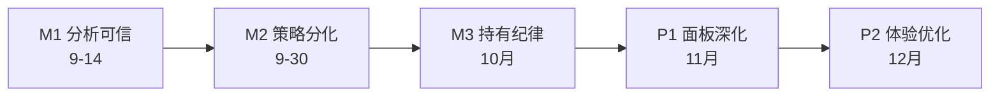

# 开发总路线

> 起始：2026-09-12 · 上游：`architecture.md` · 账本：`iteration-log.md`
> 本文件是全项目路线总入口。下面"总路线"是方向，下面各"子路线"是历史沉淀（原文保留）。
> **2026-09-23 起停止投入，转维护模式**：不再开发（P2 ⑤⑥⑦⑧ 及全部余项已归档）；日常只保留交易日 15:30 采集+选股（服务自启）；AI 分析停投，数据接口保留供外部自助（`docs/agent-api.md`）。
> **2026-09-27 恢复部分投入**：LLM 自带 Key 分析复活（M5，进行中），其余仍冻结。
> **2026-09-28 全面恢复投入**：M5 自带 Key 分析已 live + M6 纸盘全量合并进行中；P2 仍冻结。
> **2026-09-28 自带 Key 为主**：外部 agent 模式结束（无 Hermes、无外部消费方排期）；分析用用户自带 Key，外部程序 API 保留兼容。

---

## 2026-11-24 起的开发路线（当前有效；上方旧路线保留为历史）

### 0. 当前基线（2026-11-28 更新）

- 母项目 v2.2.0；vendor **paper-trading v0.10.1**（母策略/T96/P2/daily-check）。
- 纸盘：总资产 **97,125（-2.87%）**；沪深300 同期 **-6.40%**（超额 +3.52pp，样本小、且 10-23→11-19 断档，不作结论）。
- 门禁：母 **1581** / vendor **996**；A1 NAV 兜底、E0 只读桥、**E1 API + 首页卡**、**B2 绩效脚本**、**A3 覆盖报告**、**E2 执行质量**、**B3 周度审计**、**E3 绩效页**、**F 线收盘检阅（含 :8081 实际收益）**已落地；A2 二次拉取已上线，等连续 3 日验收。
- F0 已完成（11-25/26/27 三份真实新闻笔记，引用齐全、买卖建议 0）；F1 的 15:45 自动发布、首页卡、`/news` 页已在代码中，待生产重启后观察首个交易日。
- 进度评估：工程 ~82% / 决策闭环 ~40–45% / "AI 接管" ~25–30%。

### 1. 三条主线（并行但有序）

1. **数据可信**：计划窗口 freshness、K 线当日覆盖、NAV 完整、指数 5/5、`unattributed=0`。
2. **纸盘可度量**：连续运行、NAV vs 基准、决策质量（听话率/拒单/滑点）、只读桥 E1–E3。
3. **执行与接管**：条件单/止损 dry-run → 只开卖出 → 研究闭环 → 接管门槛。

### 2. 阶段与时间（验收不过不进下一阶段）

| 阶段 | 时间 | 交付 | 验收 |
|---|---|---|---|
| **P0 稳定周** | 11/24–11/30 | **A2** 17:05/17:35 二次拉取持仓+池 OHLC；A3 K 线覆盖报告；**B1** 每日运行纪律；**B2** `paper_performance.py`（NAV vs 300/红利）；**E1** `/api/paper/status` + 首页纸盘卡 | 连续 3 个交易日 16:30 `freshness=100%`；NAV 每日有行；周报能出超额（E1/B2/A3 已落地，A2 待验收） |
| **P1 度量与桥** | 12/1–12/14 | **E2** 分钟线只读 + 执行质量（成交价 vs VWAP/滑点）；**E3** 统一绩效页（纸盘 vs 基准 + AI 信号收益）；**B3** 周度听话率/拒单/费用；**R3** 策略归因启用 | 5 笔抽样复算一致；周报自动化；归因表有数据（E2/B3/E3 已落地，R3 待做） |
| **P2 盘中纪律** | 12/15–12/31 | **C0** 条件单/止损 dry-run（`engine.enabled=false`，只落 `blocked_disabled`）；风险预算与母策略仓位对齐；R5 研究页（随子项目 UI） | 2 周 dry-run 零误触发/零重复 → 只开**卖出止损** |
| **P3 接管评估** | 2027-01 | **R6** 研究→参数→纸盘→归因最小闭环；接管门槛写死；v2.3/2.4 发布 | 连续 8 周正超额、回撤 <10%、无未归因异常、人工复核 |

### 3. 版本与发布

- 母项目：**v2.3.0**（A2/A3 + E1/E3 + B2）、**v2.4.0**（C dry-run 结果 + R3）；**v3.0.0 只在接管门槛通过后**。
- 子项目：**只提 PR / 只跟 tag**；tag/Release 由子项目自己发（2026-11-23 的教训）。母仓只做 `subtree pull <tag>`。

### 4. 周度指标（每周六出表）

| 类别 | 指标 |
|---|---|
| 数据 | 计划 freshness 覆盖率、当日 K 线覆盖、基准 5/5、NAV 完整率、unattributed |
| 纸盘 | NAV 收益、vs 300/红利超额、最大回撤、换手、费用、成交/拒单、听话率 |
| 工程 | gate 通过数、事故数、服务可用性、未归因异常 |

### 5. 决策门 / 停止线

- **A2 连续 3 日 freshness <100%** → 暂停策略变更，先修数据；
- **纸盘 8 周超额为负** → 不开引擎、不扩策略；
- **dry-run 任一误触发/重复单** → 不开盘中执行；
- 任何 vendored 修改：先 PR 到子项目，母仓只跟 tag。

### 6. 明确不做（本阶段）

- 不做新 UI 功能、不多策略扩张、不接实盘、不开买入侧自动执行；
- 不手工改账本（除已记录的 NAV 复算例外）；不用 qfq 冒充 raw。

### 7. 下一步（2026-11-28 起）

1. **A2 验收**：连续 3 个交易日 16:30 `freshness=100%`（11-27 已过，待 11-30、12-01）；
2. **F1 观察**：11-30 起每个交易日 15:45 自动检阅，人工抽检引用/无建议/漏报；先不调 P0/P1 阈值；
3. **R3**：策略归因启用（E3 已把纸盘/信号收益放上 `/performance`）；
4. **B1**：连续 10 个交易日无人工干预，逐日留证据；
5. **P2 事件阈值**：等一周 dry-run 的 P0/P1 命中量，再决定是否加市场级 P2。

### 8. F 线：收盘检阅与投资笔记（与 P1 并行，不挤占 P0）

> 设计见 `docs/close-review-design.md`；核心是"新闻 → 论点/风险维护"，不是交易信号。

| 阶段 | 时间 | 交付 | 验收 |
|---|---|---|---|
| **F0 原型** | 12/1–12/7 | 3 天真实新闻 + 持仓/观察池的离线笔记（**AI 自主结论**）+ 标注集 | **完成（11-28 提前）**：11-25/26/27 三份已发布，引用 14/11/18 条、买卖建议 0、NAV 按日截断 |
| **F1 上线** | 12/8–12/21 | 15:45 收盘检阅**自动发布** + `ai_journal` 日笔记 + 首页卡；**P0/P1 重大事件提醒**（feature flag） | **代码就绪（11-28）**：scheduler 15:45/18:30、`/news` 页、事件规则引擎；待连续 5 个交易日观察（P2 市场级阈值未做） |
| **F2 融合** | 12/22–1/11 | 论点/红线、周度聚合、diff/过滤、纸盘变量**只读转接口** | 周报不重复；红线可解释；组合变量可追溯 |

前置：A2（当日 K 线）、E1（纸盘桥）先完成；F 只读消费，**新闻不进入交易**；
政策/监管变化只进周度复核，不触发盘中或次日交易。

---

## 总路线：价值投资分析面板

- **M1 分析可信**（目标 9-14）：B1 验算 + B2 三态结论，每个候选估值可验算（见 iteration-log 目标框架）
- **M2 策略分化**（目标 9-30）：B3 + B4 + `strategies.yaml` 三策略（growth/dividend/turnaround）接入流水线，独立候选池
- **M3 持有纪律**（目标 10 月）：B5 论点漂移 + B6 + B7 + 钉选股监控条件提醒
- **P1 面板深化**：✓ 收尾（②③④ 全部关闭：评分透明化 + AI 笔记增强 + 时间线交互）
- **P2 体验优化**：不再开发（2026-09-23 维护模式归档：⑤⑥⑦⑧ 停止投入）

### 已完成阶段（归档）

- **M1 分析可信** ✅ 2026-09-14 完成
- **M2 策略分化** ✅ 2026-09-20 完成
- **M3 持有纪律** ✅ 2026-09-20 完成

### 已归档（不再开发）

- **M4a 自研虚拟盘** — 已删除（原生自研包 2026-09-28 上线又被用户否决转向全量合并，git 历史可查）→ 由 M6 全量合并接替（见下）
- **M4b QLib 离线验证** — 不再开发（`scripts/backtest_topk.py` 保留为历史产物，不纳入流水线）
- **M4c 券商仿真** — 不再开发
- **M4d 实盘预备** — 不再开发
- **P2 体验优化**⑤⑥⑦⑧ — 不再开发（2026-09-23 维护模式，停止投入）
- **AI 分析本地执行** — 免费通道触发已停用（scheduler 不再调用）；分析改由自带 Key 执行（`/llm` 配置 + 队列，M5），`src/analyzer/` 为现行主力

### 新开（2026-09-28 纸盘模拟）

- **M6 纸盘模拟**（进行中）：子项目 paper-trading 全量合并 + subtree 机制化（三处一字未动）——原面板嵌回 `/paper`（直达 :8081）；Universe 走母筛选（pool-from screening）+ AI 用我们的 Key；MA/agent dry-run 与 `llm ask` 已验证；自动调度已开（2026-09-30 用户批准，母价值路线：workday 16:45 tick，`--scheme mother` + screening 15 只，一日一决策，三道闸不变）。**2026-11-19 补齐**：该调度只存在于 crontab，10-23 被一次重写丢失、停摆三周；任务已入库 `scripts/install_mother_agent_cron.sh`（幂等 + `--check`），当前 **7 条**（交易 3 + raw 2 + NAV/指数兜底 2），运行契约见 `architecture.md` §9.7。**2026-11-24**：vendored 升到 **v0.10.1**（母策略/T96/P2/daily-check）。

### 防回归门禁（AKShare 事故不再犯）

1. 数据源增删必须同步 `architecture.md` §5 注册表 + 契约单测，三者同 commit
2. 全仓 pytest 零失败（下限见 `scripts/gate-baseline.txt`，只升不降）
3. `collector/` `screener/` 改动必须附单测
4. 部署约束：开发只提交 GitHub，生产从 origin 拉取部署；禁删 S1–S10 适配函数（除非替代 + 单测同到）

### 新开（2026-09-27 恢复部分投入）

- **M5 AI 分析复活**（已上线）：LLM 自带 Key（OpenAI-compatible v1）+ `/llm` 设置页（厂商预设/连接测试/模型列表/保存）+ 队列执行（整轮/重试/单股/卡片直达/详情提问）+ token 用量显示；提示词复用 `ANALYSIS_PROMPT`（不重建），上下文压缩不建（单股 prompt 仅数千 token）

### 下一阶段规划（2026-10-23 起）：价值投资方法论完善（P0 主线）

> **唯一真相源**：`docs/value-investing-methodology.md`（完善方案，逐项含目标/数据源/实现/单测/生产验收）
> **进度跟踪**：`docs/tasklist.md`（TODO List，完成即勾选并记录验证）
> **前置**：先合并子项目 v0.6.7（Issue #1 已修复，tag 重指 `a0dd2ec`）——Phase 0。

**为什么做**：现有 7 门规 + 五维评分 + AI 分析的**纪律框架已完整**，但两处结构性缺口——(1) **估值不可复现**（内在价值/安全边际由 LLM 主观给，不可审计/回测）；(2) **质量度量是会计指标而非经济质量**（缺 ROIC vs 资本成本、增量 ROIC、资本密集度、净负债/EV），且**数据底座缺完整三表关键字段**，导致估值模型算不出 owner earnings。

**Phase 1 数据底座（P0）**
1. P0-1 股息率/分红率回填（数据已有，783 → >3000）
2. P0-2 分红历史（连续分红年数 / 每股分红序列）
3. P0-3 资产负债表关键字段（货币资金/有息负债/商誉 → 净负债/EV）
4. P0-4 现金流关键字段（折旧摊销/资本开支/营运资本 → owner earnings）
5. P0-5 历史价格序列 + 历史 PE/PB/股息率分位
6. P0-10 `financial_history` 披露日期（前视风险）

**Phase 2 估值模型（核心）**
7. P0-6 可复现估值模型（Owner Earnings / FCF 折现 + 程序化安全边际）；LLM 改为"校验 + 解释偏离"
8. P0-7 同业 / 行业估值分位

**Phase 3 验证闭环**
9. P0-8 look-ahead-safe 回测（修 `backtest_topk.py`）
10. P0-9 买入 MOS 记录 + 安全边际预测力分层验证

**Phase 4 体验与协同（择要）**
11. E1 财务同环比高亮；E2 搜索排序；C1 对齐子项目 M2；C2 观察 v0.6.5 runtime tick 日志

**明确不做**：定时巡检 / 看门狗（硬约束禁止）、P2 移动端、无判据的"优化"；组合层面归纸盘子项目。

---

# 子路线：单股详情页迭代路线（原文保留）

> 起始：2026-07-22 · 最近重写：2026-07-23
> 基线：单股详情页 12 章节已上线（AI 笔记 + 动态财务历史横向滚动 + 时间线 + 在池状态），第 10 章节行情图表用 klinecharts 自研 K 线 + AI 交易信号标注。主页大盘点击弹出指数 K 线模态框。K 线统一空心样式（candle_stroke）。

## 已有数据底座

`src/collector/akshare_fetcher.py` 已接入：
- 实时行情（`stock_zh_a_spot`）
- 业绩报表（`stock_yjbb_em`）
- 财务摘要（`stock_financial_abstract_ths`）
- 利润表（`stock_profit_sheet_by_report_em`）
- 现金流表（`stock_cash_flow_sheet_by_report_em`）

## 行情图表策略

行情类内容**自研 klinecharts**（不再 iframe 嵌入第三方网站）：
- **个股 K 线**（详情页第 10 章节）：klinecharts + 日/周/月切换 + 技术指标（MA/VOL/MACD/KDJ/RSI 可开关）+ AI 交易信号标注
- **大盘指数 K 线**（主页）：点击大盘项弹出模态框，实时拉取指数日K（akshare `stock_zh_index_daily`，不缓存）
- **K 线样式**：统一 `candle_stroke` 空心蜡烛图（中国习惯：阳线空心红边框、阴线实心绿）
- klinecharts@9.8.12 本地引用（205KB），CDN 被 ORB 阻止必须本地化

**站内独有价值**：AI 笔记、评分体系、筛选策略、时间线、AI 交易信号标注。

## 设计模式约束（已固化到 project_memory）

- **宽表格**：横向滚动容器 + `width: max-content` + 第一列 `position: sticky` + `white-space: nowrap` + 父容器 `overflow-x: hidden`
- **多卡片 grid**：卡片 `min-width: 0; overflow: hidden` 防止撑开列宽
- **LLM JSON 字段**：写模板前必须查 DB 确认实际字段名
- **零依赖优先**：评分趋势用纯 SVG 生成，不引入前端库（除非确有必要，klinecharts 除外）
- **生产服务器性能**：数据定时缓存，非实时拉取；复杂渲染评估 CPU/内存负载
- **klinecharts 渲染**：`init()` 后容器必须可见且尺寸非零，否则 canvas 尺寸为 0 无法绘制（loadKline 只切换 loading/empty 状态，不隐藏 chart 容器）
- **klinecharts 指标 API**：`createIndicator(name, isStack, {id})` 副图返回 paneId，必须保存；`removeIndicator(paneId, name)` 才能正确删除，不能把 name 当 paneId 传
- **klinecharts 蜡烛图类型**：`candle_solid`（全实心）/ `candle_stroke`（全空心）/ `candle_up_stroke`（阳线空心阴线实心）/ `candle_down_stroke`（阳线实心阴线空心）。中国习惯用 `candle_up_stroke`

---

## P0 — 已完成 ✅

### ① 行情图表（klinecharts 自研 + AI 交易信号）✅
- **方案**：klinecharts@9.8.12 本地引用（205KB），非 iframe 嵌入
- **包含**：日/周/月 K 线 + 技术指标切换（MA/VOL/MACD/KDJ/RSI 可开关）+ AI 交易信号标注
- **AI 价值**：图表下方叠加 AI 分析的 Signal（买入/持有/回避）+ 买入区间 + 目标价 + 止损位 + 置信度
- **K 线样式**：`candle_up_stroke` 空心蜡烛图（中国习惯：阳线空心红边框、阴线实心绿）
- **主页联动**：大盘指数点击弹出 K 线模态框（日/周/月切换），实时拉取 akshare `stock_zh_index_daily`，不缓存
- **根因修复**：
  - loadKline 不再隐藏 chart 容器（原 display:none 导致 canvas 尺寸为 0，klinecharts 无法渲染）
  - 副图指标 `createIndicator` 返回的 paneId 必须保存，`removeIndicator(paneId, name)` 才能正确删除（原代码误把 name 当 paneId 导致 KDJ/MACD/RSI 关不掉）
- **状态**：已部署验证，K 线样式 + 指标开关 + 大盘弹窗均通过（2026-07-23）

---

## P1 — 面板深化（进行中）

### ② 评分体系透明化
- 当前：综合评分 0-100，但用户不知分数怎么来的
- 迭代：评分卡片点击展开，显示五大维度子分数 + 加权公式 + 与行业平均对比
- 状态：✅ 2026-09-22 收口——五维子分 + 加权公式（列表页/详情页拆解块）已上线；行业均值参照（ROE/PE 板块均值 + 样本数，只读展示不改评分）四处补齐，P1② 关闭
- 数据补充：2026-09-22 sector 已接 S8 新浪 49 板块回填（原 stock_snapshot.sector 全 NULL，板块均值参照此前空转；live 实测 2999 只映射，DB 回填随合并后流水线生效）
- 依赖：现有评分逻辑

### ③ AI 笔记增强
- 当前：单条最新 AI 笔记
- 迭代：支持历史笔记对比（本周 vs 上周变化）、AI 自动检测"矛盾信号"（如 PE 下降但股价上涨）
- 依赖：现有 `ai_journal` 表

### ④ 时间线交互 ✅
- 当前：历次 AI 分析时间线纯文本
- 迭代：点击展开历史分析全文、评分变化曲线、关键事件标注（财报发布/分红/警示）
- **状态**：已实施点击展开 + Signal 标签 + 评分变化标注（↑↓ 箭头 + 差值），commit f93b456

---

## P2 — 体验优化（不再开发，2026-09-23 维护模式归档）

> 2026-09-23：停止投入，⑤⑥⑦⑧ 不再开发（归档，原文保留）。

### ⑤ 详情页内"快捷切换股票"（上一只/下一只）
### ⑥ 财务指标同环比高亮（红绿）
### ⑦ 移动端适配（当前 max-width:900px 固定，iframe 高度需自适应）
### ⑧ 搜索结果支持按 PE/ROE/市值 排序

---

## 变更记录

| 日期 | 内容 | commit |
|---|---|---|
| 2026-09-20 | 路线调整：移除 M4a/M4b/M4c/M4d，聚焦面板功能优化 | - |
| 2026-09-12 | 总路线确立（M1–M4d）+ 防回归门禁 + 子路线归档 | - |
| 2026-07-22 | 文档创建 | cd82663 |
| 2026-07-22 | P0① K 线图 spec 完成 | cd82663 |
| 2026-07-22 | K 线图实施计划 | 68e8831 |
| 2026-07-23 | kline_daily 表 + KlineDAO | 3c5b4bd |
| 2026-07-23 | fetch_kline_data 采集方法 | 8f7b961 |
| 2026-07-23 | scheduler 每日追加 K 线拉取 | 418ca84 |
| 2026-07-23 | kline API + 周月聚合 | a13df0e |
| 2026-07-23 | 详情页 klinecharts K 线图组件 | c243775 |
| 2026-07-23 | 双数据源回退（东方财富→腾讯） | 91d45c1 |
| 2026-07-23 | klinecharts 本地化解决 ORB | 1c5b506 |
| 2026-07-23 | K线volume为None导致渲染失败修复 + 首页优化 | c9e8857 |
| 2026-07-23 | 非观察池股票点击跳转东方财富行情页 | 4851d24 |
| 2026-07-23 | **废弃自研 K 线，改 iframe 嵌入东方财富** | a0ae6ba |
| 2026-07-23 | P1② 时间线交互增强 + 修复 market_snapshot bug | f93b456 |
| 2026-07-23 | **恢复 klinecharts 自研 + AI 交易信号标注** | bd07242 |
| 2026-07-23 | 主页大盘改为自研 K 线弹窗 + 空心 K 线样式 | 8a2e610 |
| 2026-07-23 | roadmap 同步大盘弹窗 + 空心K线 + P1④ 已完成 | 11d176e |
| 2026-07-23 | fix: KDJ/MACD/RSI 指标关不掉 + 阴线变空心 | 145651a |

---

## 2026-08-02 修复：周六复盘洪水循环（已修复 ✅）

- **症状**：12 天无周复盘（ai_journal 停在 7/21）；ai_watchlist_history 被灌入 3282 条重复（7/25: 2760 + 8/1: 522）
- **根因**：watchlist_reviewer._validate_and_persist 用 MarketIndexDAO 未 import → NameError → 异常分支不设 _last_review_date → scheduler 每 30s 洪水重试
- **修复**（commit ae53094）：
  - _validate_and_persist 补 MarketIndexDAO import
  - scheduler 加 _review_in_progress 防并发标志
  - 异常分支也标记当日完成（防 30s 重试）
  - complete_run 成功/跳过路径不再误传 error 参数（原来成功复盘被标 failed）
- **数据清理**：history 3287→25 条（按 code+date 保留最新）；649 条僵尸 run 标记失败；review_count 重置为真实周数
- **验证**：手动复盘端到端通过（journal 写入、history 每池股 1 条、run_log completed）
- **观察期**：8/8、8/15 两次周六复盘正常跑，验证产出质量后再定迭代方向

---

## 2026-08-11 分析理论补全（进行中）

> 分阶段补全分析理论缺口（信息丰富度评级、六关 Checklist、镜子测试、快速否决红线），全部改动在 prompt + 模板层，不改流水线。

### 阶段 A：信息丰富度评级 A/B/C（已完成 ✅）
- **prompt**（ai_analyzer.py）：ANALYSIS_PROMPT 新增 info_richness 字段（grade A/B/C + basis），指导 C 级时估值标注受限 + confidence 不得超低
- **前端**（stock_detail.html）：新增 信息丰富度评级徽章区块（A 绿 / B 黄 / C 红 + 依据一句）
- **验证**（commit c5e2829）：000792 盐湖股份复跑，产出 grade=B + 完整依据；模型池轮换正常
- **状态**：已提交推送 main

### 阶段 B：六关 Checklist（已完成 ✅）
- **prompt**（ai_analyzer.py）：ANALYSIS_PROMPT 新增 checklist 六关字段（能力圈/好生意/护城河/管理层/安全边际/纪律，各 score 1-5 + note），指导 moat/management/margin_of_safety 必须与对应单块字段一致，任一关 ≤2 → signal 不得 BUY
- **前端**（stock_detail.html）：新增 六关 Checklist评分卡（3x2 网格，★评分 + 通过绿/警示红）
- **验证**（commit 9a03be6）：000792 盐湖股份复跑，六关全产出且与 moat_evaluation/management_score 一致，signal=AVOID 与低分吻合
- **状态**：已提交推送 main

### 阶段 C：真镜子测试（已完成 ✅）
- **prompt**（ai_analyzer.py）：ANALYSIS_PROMPT 新增 mirror_test 字段（5 句模板 statements + passed + missing），保留 mirror_counts 做转折词统计；指导 passed=false 时 signal 不得 BUY
- **前端**（stock_detail.html）：新增 镜子测试区块（5 句逐一显示 + 通过/未通过徽章 + 缺失句标红）
- **验证**（commit d74e652）：000792 盐湖股份复跑，5 句完整 passed=true，signal=AVOID 一致
- **状态**：已提交推送 main

### 阶段 D：快速否决红线（已完成 ✅）
- **prompt**（ai_analyzer.py）：ANALYSIS_PROMPT 新增 veto_checklist 8 条红线（说不清赚钱/连续负FCF/诚信污点/护城河不可逆侵蚀/博傻/无法承受归零/跟风/说不清买入理由）+ triggered_count，任一 true → signal 强制 AVOID
- **前端**（stock_detail.html）：新增 快速否决红线区块（8 条逐一显示 + 触发标红 + 计数徽章）
- **复盘联动**（watchlist_reviewer.py）：新增第 5 条硬规则 check_veto_triggered（triggered_count>=1 或任一红线 true → 强制调出观察池），5 个新单测
- **验证**（commit e9b27df + 18eda31）：000792 盐湖股份复跑，触发 3 条红线（连续负FCF/护城河侵蚀/说不清理由），signal=AVOID 一致；pytest 25 passed
- **状态**：已提交推送 main
